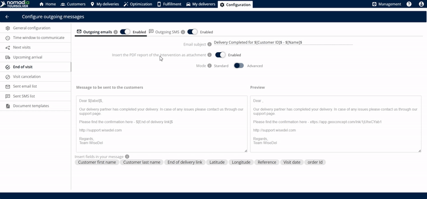
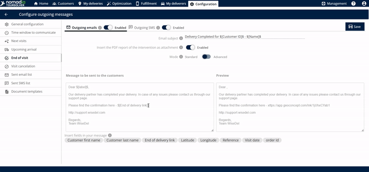
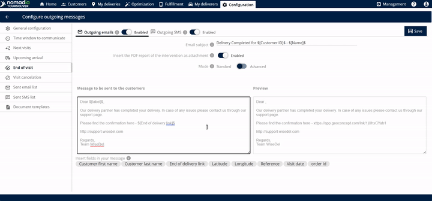
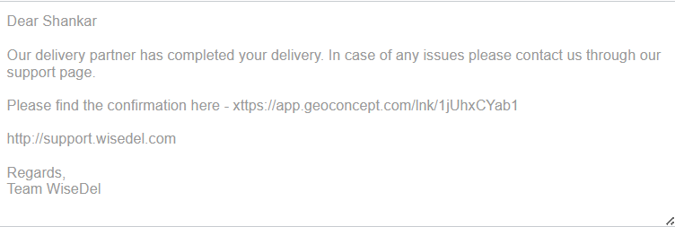

# Fin de la visita

## 1. Introducción

El **Fin de la Visita** la configuración de comunicación te permite automatizar mensajes de seguimiento enviados a tu cliente.

**¿Qué es el Fin de la Visita?** Es el proceso que ocurre **una vez que la entrega se ha completado**. Al finalizar, el cliente recibe automáticamente un correo electrónico con un archivo PDF adjunto.

**El PDF de Prueba de Entrega (PoD)** Este PDF adjunto sirve como prueba oficial de entrega. Confirma detalles esenciales para el cliente, incluyendo:

* El nombre del cliente
* La dirección del cliente
* Firmas recogidas durante la visita

## 2. Configuración inicial

Antes de enviar tu primer mensaje, debes habilitar los canales de comunicación básicos.

1. **Accede a la Configuración de Fin de Visita:**
   * Haz clic en la **Fin de la Visita** opción para acceder a la pantalla de configuración.

2. **Habilitar Canales Salientes:**
   * Activa los **correos salientes** opción

3. **Establecer el Asunto del Correo**

4. Activa el interruptor para enviar el PoD como archivo PDF

5. Haz clic en la **Guardar** botón para aplicar los cambios a la plantilla modificada.

## 3. Explicaciones de Funciones con Beneficios

Esta función ofrece flexibilidad y entrega de documentación clara.

| Función                              | Descripción                                                                                                                                      |
| ------------------------------------ | ------------------------------------------------------------------------------------------------------------------------------------------------ |
| **Enlace ETA**                       | Se crea y envía automáticamente un enlace que contiene la hora estimada de llegada (ETA) una vez que la entrega se completa.                     |
| **Edición del Asunto del Correo**    | Puedes ingresar y personalizar el **asunto del correo** para que los clientes sepan inmediatamente el propósito del mensaje.                     |
| **Edición del Cuerpo del Mensaje**   | Puedes libremente **editar el mensaje** que se enviará a tus clientes, permitiendo un lenguaje personalizado y detalles importantes              |
| **Etiquetas de Personalización ($)** | Al ingresar el **símbolo de dólar** ($) aparecen opciones que puedes insertar y editar directamente en el cuerpo del correo, ahorrándote tiempo. |
| **Ventana de Vista Previa**          | Antes de guardar, puedes ver la **vista previa** del mensaje exacto que se enviará, asegurando que se vea profesional y preciso.                 |
| **Seguimiento de Ubicación en Vivo** | El enlace permite al cliente rastrear la ubicación en vivo de la entrega (o del repartidor).                                                     |
| **Correo Saliente**                  | Opción para habilitar el envío del enlace ETA por correo electrónico.                                                                            |
| **SMS Saliente**                     | Opción para habilitar el envío del enlace ETA por mensaje de texto.                                                                              |

## 4. Personalización y Revisión del Asunto

Sigue estos pasos para personalizar el cuerpo del mensaje y confirmar la apariencia final del correo.

1. **Selecciona el Modo de Comunicación:**
   * Cambia la **modalidad de comunicación** a **estándar** o **avanzado** según el nivel de detalle que necesites.

2. **Ver el Mensaje Actual:**
   * Observa la sección que muestra el **mensaje que se enviará al cliente**.
3. **Editar el Cuerpo del Mensaje (Opcional):**
   * Si necesitas ajustar el contenido, puedes **editar este cuerpo del correo**.

4.  **Previsualizar el Correo Final:**

    * Revisa el **Asunto:** Comprueba el **vista previa** área para ver exactamente cómo se verá el correo final para el cliente. Esta es tu oportunidad para revisar el mensaje antes de guardar
    * **Insertar Información Personalizada (Opcional)** Para incluir información dinámica (como el nombre de un cliente o detalles específicos de una cita), introduce el **símbolo de dólar** ($). Esto mostrará opciones que puedes usar para editar el cuerpo del correo.

    > 💡 **Consejo:** Usar etiquetas de personalización hace que el mensaje se sienta más directo y profesional.

5. **Guardar la Configuración:**
   * Una vez que estés satisfecho con los ajustes y la vista previa, haz clic en **Guardar**.

6. El cliente recibirá el siguiente correo

<figure><figcaption></figcaption></figure>

***

## 5. Consejos de Productividad

Usa estos consejos para maximizar la efectividad y claridad de tus comunicaciones con clientes.

* **💡 Verifica Previamente el Contenido del PoD:** Recuerda que el archivo PDF adjunto es crucial. Puedes recordarte que el cliente verificará su nombre, dirección y firmas dentro del adjunto.
* **💡 Usa la Vista Previa con Frecuencia:** Antes de guardar cualquier cambio, utiliza la función de vista previa para comprobar el formato y asegurarte de que el cuerpo del mensaje se lea correctamente. La vista previa muestra exactamente lo que el cliente verá.
* **💡 Verifica la Inclusión del Adjunto:** Asegúrate siempre de haber habilitado la opción para **Insertar el informe PDF de la intervención como adjunto**. Esto garantiza que se incluya la prueba de entrega necesaria.
