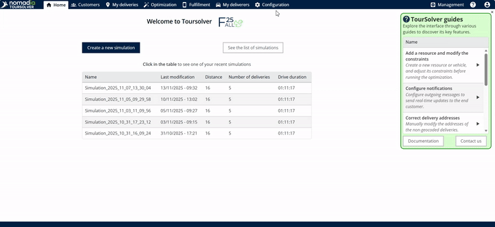
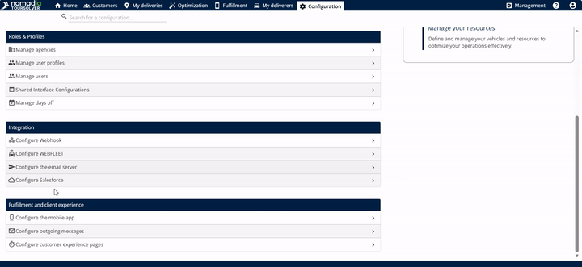
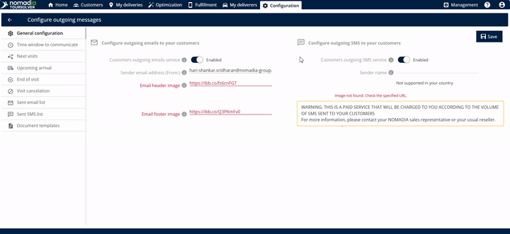
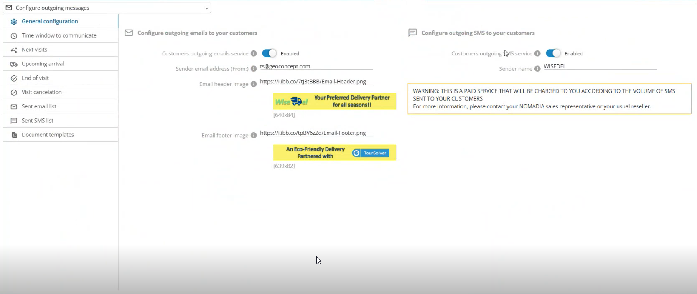
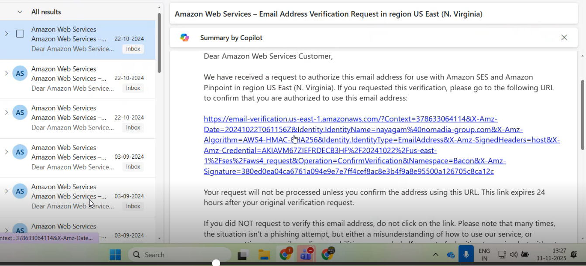
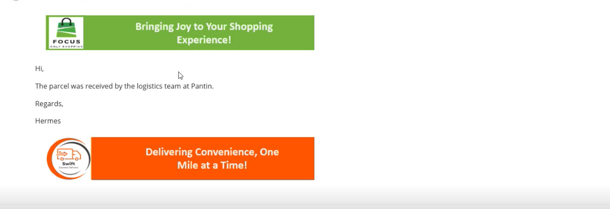

# Configuración general

## 1. Introducción

El **Configuración general de comunicación con el cliente** la pantalla le permite habilitar, deshabilitar y personalizar los ajustes fundamentales para el envío de mensajes salientes a sus clientes. Usted tiene el poder de controlar tanto el **servicio de correo saliente para clientes** y la **servicio de SMS saliente para clientes**.

## 2. Configuración Inicial

Para comenzar a configurar sus preferencias de comunicación con los clientes, debe navegar a la pantalla de Configuración General:

1. **Comience desde la Página principal:** Vaya desde el **página de inicio**.

2. Haz clic en **Configurar mensaje saliente**

3. **Abrir Configuración General:** Llegará a la **Configuración general** pantalla.

***

## 3. Explicaciones de la Función y Beneficios

Esta área de configuración gestiona dos formas potentes en las que puede contactar a sus clientes:

| Función                                       | Descripción y utilidad                                                                                                                                                                                                                 |
| --------------------------------------------- | -------------------------------------------------------------------------------------------------------------------------------------------------------------------------------------------------------------------------------------- |
| **Servicio de correo saliente para clientes** | Permite que el sistema envíe correos electrónicos a los clientes en su nombre. **Beneficio:** Puede personalizar el aspecto de sus correos electrónicos utilizando elementos de marca como sus imágenes de encabezado y pie de página. |
| **Servicio de SMS saliente para clientes**    | Permite que el sistema envíe mensajes de texto (SMS) directamente a los clientes. **Beneficio:** Proporciona comunicación rápida y directa para actualizaciones urgentes o importantes.                                                |

**Consideraciones clave para SMS:**

* ⚠️ **Advertencia: servicio de pago** – Habilitar el servicio de SMS saliente es un **servicio de pago**. Se le cobrará en función del volumen de mensajes SMS enviados a sus clientes.
* **Límite de caracteres** – Cada mensaje SMS estándar debe tener **160 caracteres**. Si su mensaje supera los 160 caracteres, el sistema automáticamente **dividirá el SMS en dos mensajes SMS**.

***

## 4. Configuración de la comunicación con el cliente

Esta sección le guía a través del proceso de configuración y activación tanto de sus canales de comunicación por correo como por SMS.

#### Habilitar y personalizar el correo saliente

Use estos pasos para activar la comunicación por correo electrónico y asegurarse de que sus correos se vean profesionales con las imágenes de su marca.

1. **Habilitar servicio de correo:** Una vez que esté en la pantalla de Configuración General, habilite el **servicio de correo saliente para clientes**.
2. **Introduzca el correo del remitente:** Introduzca el **dirección de correo del remitente**.

3. **Agregar enlace de imagen de encabezado/pie de página (opcional):** Ingresa el **enlace de imagen de encabezado/pie de página**. Esto a menudo contiene información legal o datos de contacto. 💡 **Consejo:** Si no introduce un enlace de imagen de encabezado y un enlace de imagen de pie de página, el correo resultante se enviará sin estos elementos visuales.

#### Habilitar SMS saliente

1. **Habilitar servicio de SMS:** Localice y habilite el **servicio de SMS saliente para clientes**.
   * **Contexto:** Si habilita este servicio, sus clientes comenzarán a recibir mensajes SMS del sistema.

#### Guardar cambios y validar su correo

Para activar su configuración de comunicación, debe guardar sus modificaciones y completar un paso de validación importante.

2. **Recibir correo de validación:** Después de hacer clic **guardar**, el sistema enviará automáticamente un correo a la dirección de remitente que proporcionó. Este correo incluye un **enlace para validar el correo**.

<figure><figcaption></figcaption></figure>

3. **Hacer clic en el enlace de validación:** Vaya a su bandeja de entrada, abra el correo de validación y haga clic en el enlace proporcionado.

<figure><figcaption></figcaption></figure>

4. **Activación confirmada:** Una vez que haga clic en el enlace, el sistema estará autorizado para enviar correos a los clientes **en su nombre**.

<figure><figcaption></figcaption></figure>

***

## 5. Consejos de Productividad

Aquí tiene algunos consejos para maximizar su efectividad al usar los ajustes de Configuración General:

* 💡 **Identidad de marca consistente:** Procure siempre introducir tanto el **enlace de la imagen de encabezado** y la **enlace de la imagen de pie de página**. El uso de estos enlaces ayuda a mantener una imagen de marca profesional para todos los correos enviados a sus clientes.
* ⚠️ **Controle su recuento de caracteres:** El envío de SMS es una suscripción de pago y al enviar mensajes SMS, recuerde el **límite de 160 caracteres**. Mantenga sus mensajes concisos para evitar que se dividan en dos mensajes separados sujetos a cobro.
* 💡 **Validación inmediata:** Para asegurar una entrega de correo sin problemas, complete el paso de validación inmediatamente después de hacer clic **guardar**. El enlace de validación confirma que el sistema (TourSolver) tiene permiso para enviar mensajes usando la dirección de remitente que eligió.
