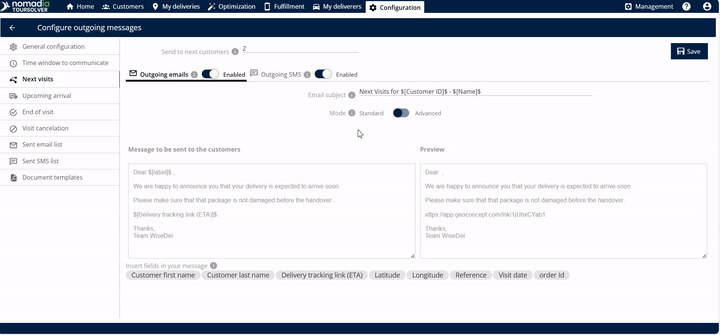
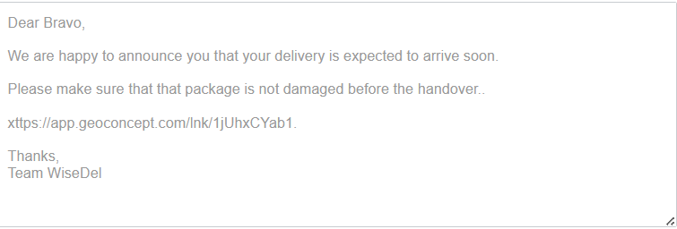

# Siguientes visitas

## 1. Introducción

El **Próximas visitas** la función está diseñada para automatizar notificaciones, informando a sus clientes próximos que usted está en camino. Esto garantiza una comunicación fluida y una mejor preparación para su llegada.

Puede elegir exactamente cuántos clientes próximos reciben este mensaje, personalizar el contenido y decidir si enviarlo por correo electrónico o SMS.

## 2. Configuración Inicial

Su primer paso es definir cómo notificará a sus clientes próximos.

**Acceder a la función Próximas visitas:** Haz clic en **próximas visitas**.

**Definir el número objetivo de clientes** Especifique la cantidad de clientes próximos que desea notificar. Puede elegir enviar una notificación al siguiente, a los dos siguientes o a los tres siguientes clientes.

* Si ingresa **uno**, el correo electrónico se envía al siguiente cliente.
* Si ingresa **dos**, el correo electrónico se envía a los dos siguientes clientes.
* Si ingresa **tres** (o cualquier número que desee), el correo electrónico se envía a esa cantidad de clientes.

***

## 3. Explicaciones de Funciones con Beneficios

La fortaleza de esta herramienta radica en su personalización y en su mecanismo de activación.

| Función                              | Descripción                                                                                                                                      |
| ------------------------------------ | ------------------------------------------------------------------------------------------------------------------------------------------------ |
| **Enlace ETA**                       | Se crea y envía automáticamente un enlace que contiene la hora estimada de llegada (ETA) una vez que la entrega se completa.                     |
| **Edición del Asunto del Correo**    | Puedes ingresar y personalizar el **asunto del correo** para que los clientes sepan inmediatamente el propósito del mensaje.                     |
| **Edición del Cuerpo del Mensaje**   | Puedes libremente **editar el mensaje** que se enviará a tus clientes, permitiendo un lenguaje personalizado y detalles importantes              |
| **Etiquetas de Personalización ($)** | Al ingresar el **símbolo de dólar** ($) aparecen opciones que puedes insertar y editar directamente en el cuerpo del correo, ahorrándote tiempo. |
| **Ventana de Vista Previa**          | Antes de guardar, puedes ver la **vista previa** del mensaje exacto que se enviará, asegurando que se vea profesional y preciso.                 |
| **Seguimiento de Ubicación en Vivo** | El enlace permite al cliente rastrear la ubicación en vivo de la entrega (o del repartidor).                                                     |
| **Correo Saliente**                  | Opción para habilitar el envío del enlace ETA por correo electrónico.                                                                            |
| **SMS Saliente**                     | Opción para habilitar el envío del enlace ETA por mensaje de texto.                                                                              |

## 4. Personalice y guarde la configuración de comunicación con el cliente

Esta tarea asegura que sus clientes próximos reciban un mensaje personalizado informándoles de su llegada inminente.

1. **Introduzca el asunto del correo electrónico:** Encuentre el campo para el asunto del correo y escriba un título claro y conciso.

2. **Editar el contenido del mensaje** Personalice el cuerpo del mensaje que se enviará a sus clientes.
3.  **Insertar Información Personalizada (Opcional)** Para incluir información dinámica (como el nombre de un cliente o detalles específicos de una cita), introduce el **símbolo de dólar** ($). Esto mostrará opciones que puedes usar para editar el cuerpo del correo.

    > 💡 **Consejo:** Usar etiquetas de personalización hace que el mensaje se sienta más directo y profesional.

4. **Revise el asunto:** Comprueba el **vista previa** área para ver exactamente cómo se verá el correo final para el cliente. Esta es su oportunidad de revisar el mensaje antes de guardar.
5. **Guarde su configuración** Una vez que haya introducido y modificado toda la información necesaria, haga clic en **guardar**.

6. El cliente recibirá el siguiente correo.&#x20;

<figure><figcaption></figcaption></figure>

***

## 5. Consejos de Productividad

Aquí tiene algunos consejos para maximizar la eficiencia de la función de comunicación Próximas visitas:

1. **Maximice la personalización:** Utilice siempre el símbolo de dólar ($) al editar el cuerpo del mensaje. Esto asegura que utilice los campos disponibles para contenido dinámico, creando una comunicación profesional y detallada sin tener que ingresar manualmente la información cada vez.
