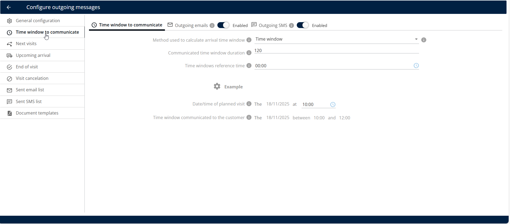
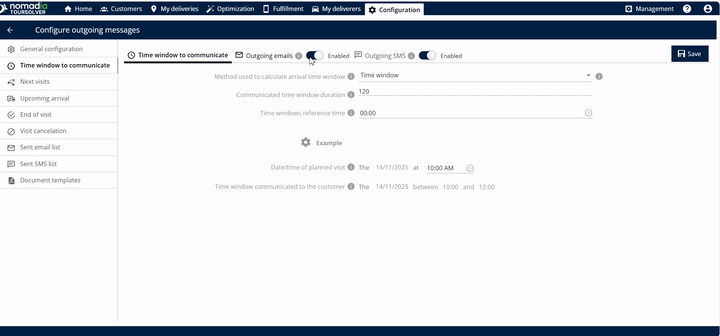
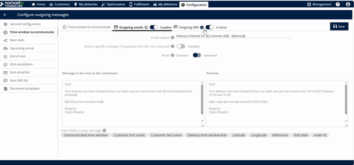
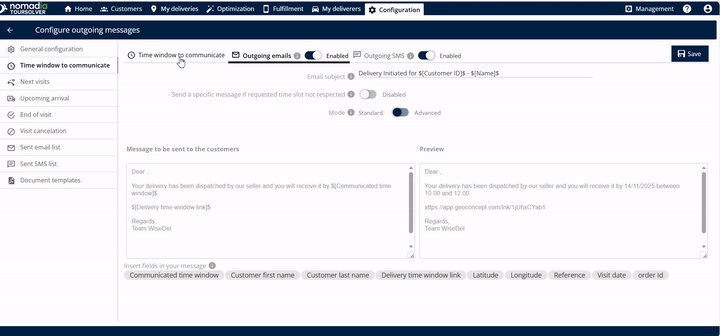
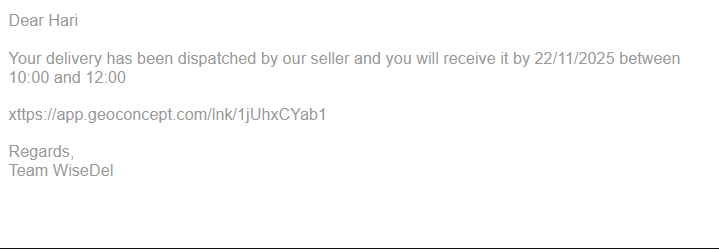

# Ventana de tiempo para comunicar

## 1. Introducción

El **Ventana de tiempo para comunicar** la función le permite definir el marco temporal exacto comunicado a su cliente con respecto a una visita próxima. Esto calcula la ventana de llegada y gestiona la comunicación saliente por correo electrónico y SMS.

## 2. Configuración Inicial

1. Haz clic en **Ventana de tiempo para comunicar**.

<figure><figcaption></figcaption></figure>

***

## 3. Explicaciones de la Función y Beneficios

Esta función es poderosa porque le permite controlar exactamente cómo se calcula y entrega la información de llegada.

| Función                              | Descripción                                                                                                                                      |
| ------------------------------------ | ------------------------------------------------------------------------------------------------------------------------------------------------ |
| **Enlace ETA**                       | Se crea y envía automáticamente un enlace que contiene la hora estimada de llegada (ETA) una vez que la entrega se completa.                     |
| **Edición del Asunto del Correo**    | Puedes ingresar y personalizar el **asunto del correo** para que los clientes sepan inmediatamente el propósito del mensaje.                     |
| **Edición del Cuerpo del Mensaje**   | Puedes libremente **editar el mensaje** que se enviará a tus clientes, permitiendo un lenguaje personalizado y detalles importantes              |
| **Etiquetas de Personalización ($)** | Al ingresar el **símbolo de dólar** ($) aparecen opciones que puedes insertar y editar directamente en el cuerpo del correo, ahorrándote tiempo. |
| **Ventana de Vista Previa**          | Antes de guardar, puedes ver la **vista previa** del mensaje exacto que se enviará, asegurando que se vea profesional y preciso.                 |
| **Seguimiento de Ubicación en Vivo** | El enlace permite al cliente rastrear la ubicación en vivo de la entrega (o del repartidor).                                                     |
| **Correo Saliente**                  | Opción para habilitar el envío del enlace ETA por correo electrónico.                                                                            |
| **SMS Saliente**                     | Opción para habilitar el envío del enlace ETA por mensaje de texto.                                                                              |

## 4. Configuración de la ventana de tiempo de comunicación con el cliente y las notificaciones

Siga estos pasos para definir la ventana de tiempo precisa y habilitar la comunicación para la visita de su cliente.

1. **Acceda a la función:** Haz clic en **Ventana de tiempo para comunicar**.
2. **Defina el método de cálculo:**
   * Seleccione el método de ventana de tiempo que se utiliza para calcular la ventana de tiempo de llegada.

3. **Establezca la duración:**
   * Ingrese la duración de la ventana de tiempo comunicada.

💡 \*\*Consejo:\*\* Introducir \*\*120 minutos\*\* resultará en una ventana de 2 horas comunicada al cliente (p. ej., de 10:00 a.m. a 12:00 p.m.).

4\. **Seleccione la hora de referencia:**

5. **Introduzca los detalles de la visita planificada:**
   * Localice el **Fecha y hora de la visita planificada** campo.

6. **Revise la ventana de tiempo calculada:**
   * El sistema mostrará la **ventana de tiempo comunicada al cliente**.
   * Por ejemplo, si establece la duración en 2 horas, el sistema podría calcular la ventana como de 10:00 a.m. a 12:00 p.m..
7.  **Habilitar Comunicación por Correo:**

    * Puede habilitar la **correos salientes** opción.
    * Revise el mensaje que debe enviarse al cliente debajo de esta sección.
    * **Insertar Información Personalizada (Opcional)** Para incluir información dinámica (como el nombre de un cliente o detalles específicos de una cita), introduce el **símbolo de dólar** ($). Esto mostrará opciones que puedes usar para editar el cuerpo del correo.

    &#x20;      💡 **Consejo:** Usar etiquetas de personalización hace que el mensaje se sienta más directo y profesional

8.  **Habilitar Comunicación por SMS (Opcional):**

    * También puede habilitar la **SMS salientes** opción.
    * **Insertar Información Personalizada (Opcional)** Para incluir información dinámica (como el nombre de un cliente o detalles específicos de una cita), introduce el **símbolo de dólar** ($). Esto mostrará opciones que puedes usar para editar el cuerpo del correo.

    > 💡 **Consejo:** Usar etiquetas de personalización hace que el mensaje se sienta más directo y profesional.

9. **Guarde Sus Configuraciones:**

10. El cliente recibirá el siguiente correo

<figure><figcaption></figcaption></figure>

## 5. Consejos de Productividad

Estos consejos le ayudarán a trabajar de forma más eficiente y a garantizar una comunicación fluida con sus clientes:

* **Use la función de vista previa:** Use siempre la opción de mensaje **vista previa** disponible tanto para correos electrónicos salientes como para SMS salientes. Esto le ayuda a confirmar exactamente lo que verá el cliente antes de guardar sus ajustes, garantizando precisión y claridad.
* **Mantenga las duraciones claras:** Al establecer la **Duración de la ventana de tiempo comunicada**, elija incrementos comunes (como 60 minutos o 120 minutos) que sean fáciles de entender para los clientes. Una ventana clara y definida evita confusiones.
