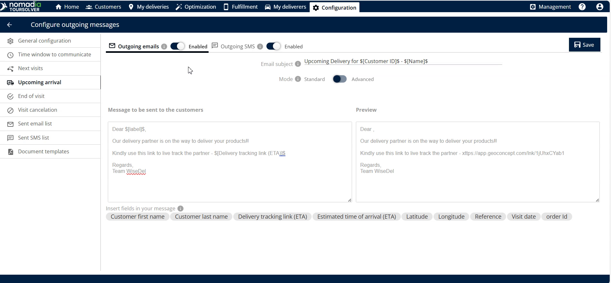
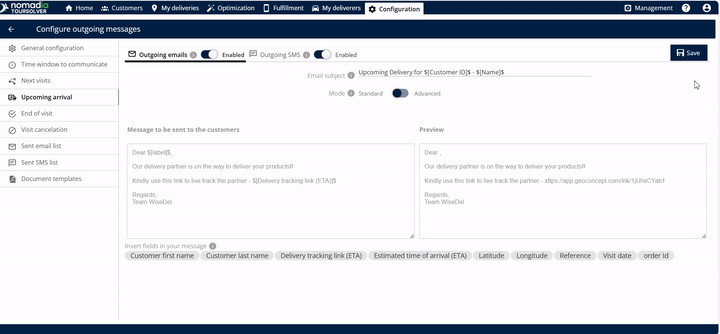

# Próxima llegada

## 1. Introducción

El **Próximo Llegada** la función mejorará la experiencia del cliente proporcionando actualizaciones del estado de la entrega en tiempo real. Genera y envía automáticamente un enlace de Hora Estimada de Llegada (ETA) a su cliente una vez que comienza el proceso de entrega.

**El beneficio principal es la transparencia**: Cuando el cliente hace clic en este enlace, puede **seguir la ubicación en vivo del repartidor**.

## 2. Configuración Inicial

Para comenzar a usar esta función, primero debe navegar a **Próximo Llegada**

## 3. Explicaciones de la Función con Beneficios

La función Próximo Llegada permite una comunicación proactiva, asegurando que los clientes estén listos para recibir sus artículos.

| Función                              | Descripción                                                                                                                                        |
| ------------------------------------ | -------------------------------------------------------------------------------------------------------------------------------------------------- |
| **Enlace ETA**                       | Se crea y envía automáticamente un enlace que contiene la hora estimada de llegada (ETA) una vez que la entrega se completa.                       |
| **Edición del Asunto del Correo**    | Puede introducir y personalizar el **asunto del correo** para que los clientes sepan inmediatamente el propósito del mensaje.                      |
| **Edición del Cuerpo del Mensaje**   | Puede libremente **editar el mensaje** que se enviará a sus clientes, permitiendo un lenguaje personalizado y detalles importantes                 |
| **Etiquetas de Personalización ($)** | Al ingresar el **símbolo de dólar** ($) se muestran opciones que puede insertar y editar directamente en el cuerpo del correo, ahorrándole tiempo. |
| **Ventana de Vista Previa**          | Antes de guardar, puede ver la **vista previa** del mensaje exacto que se enviará, asegurando que se vea profesional y preciso.                    |
| **Seguimiento de Ubicación en Vivo** | El enlace permite al cliente rastrear la ubicación en vivo de la entrega (o del repartidor).                                                       |
| **Correo Saliente**                  | Opción para habilitar el envío del enlace ETA por correo electrónico.                                                                              |
| **SMS Saliente**                     | Opción para habilitar el envío del enlace ETA por mensaje de texto.                                                                                |

## 4. Configuración de Notificaciones al Cliente

Esta es la acción principal que realizará: elegir los canales de comunicación para el enlace de ETA y ubicación en vivo.

1. **Acceda a la Configuración:** Navegue hasta y haga clic en **Próximo Llegada** (ver los pasos de Configuración Inicial arriba).
2. **Habilitar Comunicación por Correo:** Seleccione la opción para habilitar **correos salientes**.

3. **Habilitar Comunicación por SMS (Opcional):** Seleccione la opción para habilitar **SMS salientes**.
4. **Insertar Información Personalizada (Opcional)** Para incluir información dinámica (como el nombre del cliente o detalles específicos de la cita), ingrese el **símbolo de dólar** ($). Esto mostrará opciones que puede usar para editar el cuerpo del correo.

&#x20;      💡 **Consejo:** El uso de etiquetas de personalización hace que el mensaje se sienta más directo y profesional.

5. **Revisar el Contenido del Mensaje (Recomendado):** Para confirmar la experiencia del cliente, seleccione la opción para **ver la vista previa del correo**.
6. **Guarde Sus Configuraciones:** Una vez que esté satisfecho con los canales habilitados y la vista previa, haga clic en **guardar**.

7. El cliente recibirá el siguiente correo.&#x20;

<figure><figcaption></figcaption></figure>

***

## 5. Consejos de Productividad

Aquí hay algunas formas de maximizar la efectividad de sus comunicaciones de próximo llegada:

* 💡 **Comunicación por Doble Canal:** Considere habilitar **ambos** correos salientes y SMS salientes. Usar ambos métodos garantiza que el cliente reciba la información crítica de ETA independientemente de si revisa primero su bandeja de entrada o sus mensajes de texto.
* 💡 **Siempre Previsualice:** Use la opción para **ver la vista previa del correo** antes de guardar los cambios de configuración. Esta es su oportunidad para verificar que el mensaje contenga el enlace de la ubicación en vivo como se espera.
* ⚠️ **Comprender los Puntos de Activación:** Recuerde que el enlace ETA se envía _una vez que el repartidor completa la fase de entrega_ (es decir, que están en camino al cliente). Asegúrese de que sus definiciones operativas de "completa la entrega" se alineen con cuándo desea que el cliente comience a rastrear la ubicación en vivo.
