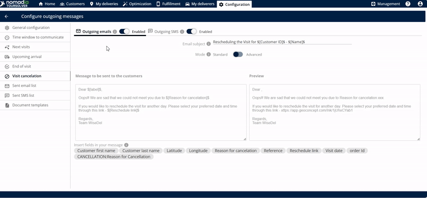
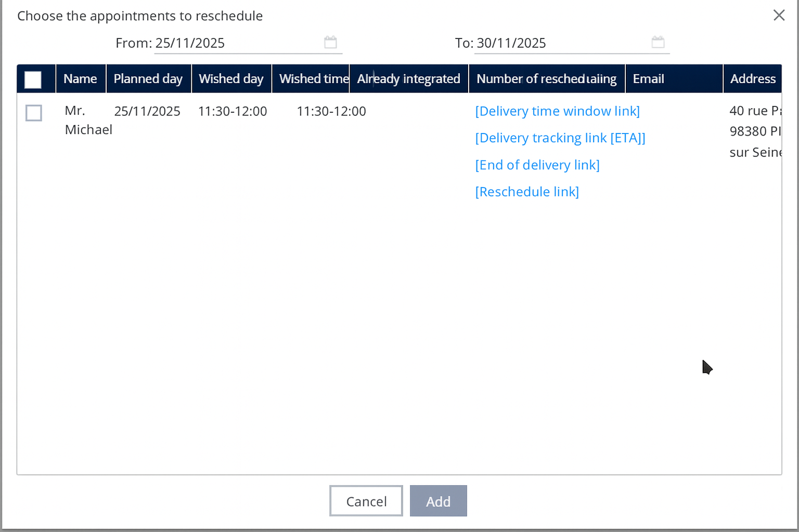

# Cancelación de visita

## 1. Introducción

Este proceso le permite marcar una visita como cancelada mientras activa simultáneamente una acción que solicita al cliente final que seleccione una nueva fecha y hora para reprogramar.

## 2. Configuración Inicial&#x20;

Antes de procesar una cancelación, debe asegurarse de que los canales de comunicación estén activos para que el cliente reciba el enlace de reprogramación.

1. **Acceda a la Configuración de Cancelación:** Haz clic en la **cancelación de la visita** opción.
2. **Habilitar Mensajes Salientes:** Asegúrese de que ambos tipos de comunicación saliente estén activados:
   * **Correos electrónicos salientes**
   * **SMS Saliente**
3. **Establecer el Asunto (Correos y SMS):** Mencione el **asunto** específico que desea que el cliente vea.

***

## 3. Explicaciones de la Función y Beneficios

Esta función agiliza la comunicación y la logística cuando un intento de entrega falla debido a la indisponibilidad del cliente.

| Función                              | Descripción                                                                                                                                      |
| ------------------------------------ | ------------------------------------------------------------------------------------------------------------------------------------------------ |
| **Enlace ETA**                       | Se crea y envía automáticamente un enlace que contiene la hora estimada de llegada (ETA) una vez que la entrega se completa.                     |
| **Edición del Asunto del Correo**    | Puedes ingresar y personalizar el **asunto del correo** para que los clientes sepan inmediatamente el propósito del mensaje.                     |
| **Edición del Cuerpo del Mensaje**   | Puedes libremente **editar el mensaje** que se enviará a tus clientes, permitiendo un lenguaje personalizado y detalles importantes              |
| **Etiquetas de Personalización ($)** | Al ingresar el **símbolo de dólar** ($) aparecen opciones que puedes insertar y editar directamente en el cuerpo del correo, ahorrándote tiempo. |
| **Ventana de Vista Previa**          | Antes de guardar, puedes ver la **vista previa** del mensaje exacto que se enviará, asegurando que se vea profesional y preciso.                 |
| **Seguimiento de Ubicación en Vivo** | El enlace permite al cliente rastrear la ubicación en vivo de la entrega (o del repartidor).                                                     |
| **Correo Saliente**                  | Opción para habilitar el envío del enlace ETA por correo electrónico.                                                                            |
| **SMS Saliente**                     | Opción para habilitar el envío del enlace ETA por mensaje de texto.                                                                              |

💡 **Consejo:** El cuerpo del correo electrónico incluye automáticamente la **razón de la cancelación** y la **fecha de reprogramación** información.

**Insertar Información Personalizada (Opcional)** Para incluir información dinámica (como el nombre de un cliente o detalles específicos de una cita), introduce el **símbolo de dólar** ($). Esto mostrará opciones que puedes usar para editar el cuerpo del correo.

💡 **Consejo:** Usar etiquetas de personalización hace que el mensaje se sienta más directo y profesional.

#### Gestión de Citas Reprogramadas&#x20;

Después de que una visita se cancele, el repartidor debe volver a incorporar la cita en el horario una vez que se seleccione una nueva fecha.

**Encontrar los Datos**

1. **Acceda a Cumplimiento:** Vaya a la **pestaña de cumplimiento**.
2. **Ver Lista de Cancelados:** Haz clic en **para reprogramar**.
3. **Revisar Datos:** Puede **ver los datos reprogramados aquí**.

<figure><figcaption></figcaption></figure>

**Agregar la Cita de Nuevo al Horario**

1. **Acceder a Herramientas del Repartidor:** El repartidor debe hacer clic en **mis entregas**.
2. **Seleccionar Citas:** Haz clic en **agregar citas para reprogramar**.
3. **Listar y Agregar:** **Enumere los datos aquí** y haga clic **agregar**.

**Resultado Esperado:** Las visitas reprogramadas **se agregarán con éxito a la siguiente simulación/optimización**.

<figure><figcaption></figcaption></figure>

## 5. Consejos de Productividad

* **Siempre Habilite Ambos:** Para alcanzar al máximo número de clientes, asegúrese de **activar los correos electrónicos salientes y los SMS salientes** al configurar la cancelación. Esta función está disponible a través de múltiples canales, lo que garantiza que los clientes puedan acceder a ella incluso si se pierde un método.
* **Use la Función de Vista Previa:** Antes de hacer clic **guardar**, siempre utilice la función para **ver la vista previa del correo**. Esto confirma que la razón de la cancelación y el enlace de reprogramación se muestran correctamente, evitando errores de comunicación.
* **Rastrear Elementos Reprogramados:** Revise regularmente el **pestaña de cumplimiento** bajo **para reprogramar**. Esto asegura que no se pasen por alto visitas canceladas y mantiene su flujo de trabajo logístico actualizado.
