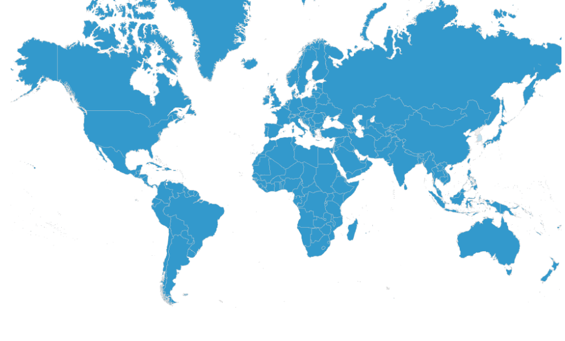

# 17. ¿Qué países están cubiertos por TourSolver?

A fecha de **2 de mayo de 2018 (versión 5.0)**, TourSolver ofrece cobertura de enrutamiento y optimización en **aproximadamente 230 países**, que representan **más de 7.2 mil millones de personas**.\
Con incorporaciones recientes como **Bangladés, Bután, Maldivas, Nepal, Pakistán y Sri Lanka**, TourSolver ahora cubre **casi todo el planeta**.

### **🌍 Países no cubiertos**

* **Corea del Norte**
* **Corea del Sur**

<figure><figcaption></figcaption></figure>

La cobertura está organizada por región, y algunas regiones incluyen **sectorización geográfica** (disponible en la **versión Premium**). A continuación se muestra la lista completa de países cubiertos y el estado de disponibilidad de Premium.

***

### **🌍 Europa**

**Sectorización geográfica disponible en Premium**

ALBANIA, ALEMANIA, ANDORRA, ARMENIA, AUSTRIA, AZERBAIYÁN, BIELORRUSIA, BÉLGICA, BOSNIA Y HERZEGOVINA, BRASIL, BULGARIA, CHIPRE, CROACIA, DINAMARCA, ESPAÑA, ESTONIA, FEDERACIÓN RUSA, FINLANDIA, FRANCIA, GEORGIA, GRECIA, GROENLANDIA, HUNGRÍA, ISLA DE MAN, ISLAS FEROE, IRLANDA, ISLANDIA, ITALIA, KAZAJISTÁN, KIRGUISTÁN, LETONIA, LIECHTENSTEIN, LITUANIA, LUXEMBURGO, MALTA, MONTENEGRO, NORUEGA, UZBEKISTÁN, PAÍSES BAJOS, POLONIA, PORTUGAL, MACEDONIA DEL NORTE, MOLDAVIA, REPÚBLICA CHECA, RUMANIA, REINO UNIDO, SERBIA, ESLOVAQUIA, ESLOVENIA, SUECIA, SUIZA, TAYIKISTÁN, TURKMENISTÁN, TURQUÍA, UCRANIA.

***

### **🌍 África y Oriente Medio**

**Sectorización geográfica NO disponible en Premium**

Afganistán, Sudáfrica, Argelia, Angola, Arabia Saudita, Baréin, Franja de Gaza, Benín, Botsuana, Burkina Faso, Burundi, Camerún, Cabo Verde, Comoras, República Democrática del Congo, República del Congo, Costa de Marfil, Yibuti, Egipto, Emiratos Árabes Unidos, Eritrea, Etiopía, Gabón, Gambia, Ghana, Guinea, Guinea Ecuatorial, Guinea-Bisáu, Iraq, Irán, Israel, Jordania, Kenia, Kuwait, Lesoto, Líbano, Liberia, Libia, Madagascar, Malaui, Malí, Marruecos, Mauricio, Mauritania, Mayotte, Mozambique, Namibia, Níger, Nigeria, Omán, Uganda, Palestina, Catar, República Centroafricana, Reunión, Ruanda, Sáhara Occidental, Santo Tomé y Príncipe, Senegal, Seychelles, Sierra Leona, Somalia, Sudán, Sudán del Sur, Santa Elena–Ascensión–Tristán da Cunha, Suazilandia (Esuatini), Siria, Tanzania, Chad, Togo, Túnez, Yemen, Zambia, Zimbabue.

***

### **🌍 Norte y Centroamérica**

**Sectorización geográfica disponible en Premium**

Bahamas, Belice, Bermudas, Canadá, Costa Rica, Cuba, Islas Caimán, República Dominicana, Guatemala, Honduras, Haití, Jamaica, México, Nicaragua, Panamá, Puerto Rico, El Salvador, San Pedro y Miquelón, Islas Turcas y Caicos, Estados Unidos, Islas Vírgenes Británicas, Islas Vírgenes de EE. UU.

***

### **🌍 Sudamérica y el Caribe**

**Sectorización geográfica NO disponible en Premium**

Aruba, Anguila, Argentina, Antigua y Barbuda, St. Eustatius, Saba, Bonaire, San Bartolomé, Bolivia, Brasil, Barbados, Chile, Colombia, Curazao, Dominica, Ecuador, Islas Malvinas, Guadalupe, Granada, Guyana, Guayana Francesa, San Cristóbal y Nieves, Santa Lucía, San Martín, Montserrat, Martinica, Perú, Paraguay, Georgia del Sur y las Islas Sandwich del Sur, Surinam, Sint Maarten, Trinidad y Tobago, Uruguay, San Vicente y las Granadinas, Venezuela.

***

### **🌍 Asia**

**Sectorización geográfica NO disponible en Premium**

Bangladés, Bután, China _(disponible solo desde dentro de China)_, India, Maldivas, Nepal, Pakistán, Sri Lanka, Japón.

***

### **🌍 Sudeste Asiático**

**Sectorización geográfica NO disponible en Premium**

Brunéi, Guam, Hong Kong, Indonesia, Camboya, Laos, Macao, Birmania, Mongolia, Islas Marianas, Malasia, Filipinas, Islas Paracelso, Palaos, Papúa Nueva Guinea, Singapur, Islas Salomón, Islas Spratly, Tailandia, Timor Oriental, Vietnam, Taiwán.

***

### **🌍 Oceanía**

**Sectorización geográfica NO disponible en Premium**

Australia, Micronesia, Fiyi, Islas Cook, Islas Marshall, Kiribati, Nauru, Niue, Nueva Caledonia, Nueva Zelanda, Polinesia Francesa, Samoa, Samoa Americana, Tokelau, Tonga, Tuvalu, Vanuatu, Wallis y Futuna.
