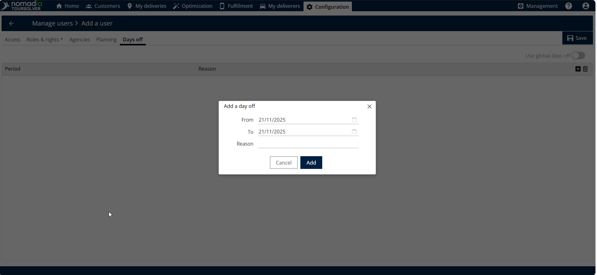

# Crear y modificar un usuario

## 1. Introducción

Esta guía proporciona instrucciones paso a paso para configurar nuevos miembros del equipo y actualizar los detalles, roles o horarios de los usuarios actuales. ¡Siguiendo estos sencillos pasos, podrás gestionar las configuraciones de acceso con confianza y eficiencia!

## 2. Configuración Inicial

El primer paso para crear o modificar cualquier usuario es acceder al área principal de configuración desde la página de inicio.

Para comenzar a crear o modificar un usuario, sigue estos pasos:

1. Desde la **página de inicio**, ve a la **configuración.**
2. Haz clic en **Gestionar Usuarios.**

<figure><figcaption></figcaption></figure>

<figure><figcaption></figcaption></figure>

3. Haz clic en **menú Acciones**.
4. Haz clic en **Añadir**

<figure><figcaption></figcaption></figure>

## 3. Explicaciones de la Función y Beneficios

Cuando creas o modificas un usuario, interactuarás con varias secciones clave para definir su acceso y programación.

| Sección              | Propósito (Contexto)                                                                                              | Acciones clave                                                                                   |
| -------------------- | ----------------------------------------------------------------------------------------------------------------- | ------------------------------------------------------------------------------------------------ |
| **Acceso**           | Define la identidad básica y los permisos de inicio de sesión (web y móvil) para el usuario.                      | Ingresa ID de inicio de sesión, nombres y establezca la contraseña inicial para el usuario móvil |
| **Roles y Derechos** | Determina lo que el usuario puede ver y hacer dentro de la aplicación (por ejemplo, administrador, optimización). | Activa los roles y derechos necesarios, como **administrador** o **optimización**.               |
| **Agencias**         | Asigna las agencias específicas de las que el usuario es responsable o a las que necesita acceso.                 | Selecciona las agencias requeridas y use la **flecha derecha** para asignarlas.                  |
| **Planificación**    | Te permite planificar el tiempo de turno para el usuario.                                                         | Toca el día y la hora para establecer el tiempo de turno, luego toque **actualizar**.            |
| **Días Libres**      | Te permite preplanificar y registrar cualquier día libre que el usuario tenga previsto tomar.                     | Ingresa el **desde la fecha** y **a fecha** para el tiempo libre planificado.                    |

**Nota**: La planificación y los días libres estarán accesibles solo para el usuario móvil. Los roles y derechos estarán accesibles solo para el usuario web

## 4. Creación de usuarios

Puedes crear un usuario completamente desde cero o modificar eficientemente un usuario existente usando sus datos como plantilla.

### Crear un usuario desde cero

Esto es necesario al incorporar a un nuevo empleado que requiere un ID de inicio de sesión único y roles definidos.

1. Después de navegar a la pantalla Agregar, confirma que está creando un usuario desde cero.
2. Primero, veamos cómo crear el usuario desde cero. Haz clic en **Aceptar** – Inicia la creación de un nuevo usuario.

<figure><figcaption></figcaption></figure>

<figure><figcaption></figcaption></figure>

3. Rellena los detalles de acceso: en la sección Acceso, ingresa la información requerida: **ID de inicio de sesión, Nombre y Apellidos**
4. Establecer **Tipo de Acceso** y **Contraseña:** Para el acceso web, activa la opción Acceso web, y para el acceso móvil, active la opción Acceso móvil.
5. Ingresa la **contraseña**

**Consejo**: Puedes activar tanto las opciones de Acceso web como de Acceso móvil al mismo tiempo si el usuario requiere ambos. ⚠ Advertencia (Requisito de contraseña): La contraseña debe contener 8 caracteres, incluyendo un carácter numérico y un carácter especial.

<figure><figcaption></figcaption></figure>

<figure><figcaption></figcaption></figure>

6. **Definir roles y derechos**: En la sección Roles y Derechos, activa todos los roles necesarios, como administrador, optimización o depósito.&#x20;
7. **Asignar agencias**: En la sección Agencias, haz clic en las agencias que necesita asignar y luego haz clic en la flecha derecha para moverlas a la lista asignada.

<figure><figcaption></figcaption></figure>

<figure><figcaption></figcaption></figure>

8. **Planificar tiempo de turno**: En la sección Planificación, haz clic en el día y la hora para establecer el tiempo de turno deseado y luego haz clic en actualizar.

<figure><figcaption></figcaption></figure>

<figure><figcaption></figcaption></figure>

**Programar días libres (Opcional): En la sección Días libres, puedes planificar vacaciones futuras:**

9. Haz clic en la **símbolo más** icono en el lado derecho.
10. Ingresa el **desde la fecha** y la **a fecha** para el día libre.
11. Haz clic en **Añadir**

<figure><figcaption></figcaption></figure>

<figure><figcaption></figcaption></figure>

12. **Guardar el usuario**: Después de completar toda la información requerida, haz clic en **Guardar** para finalizar la creación.

<figure><figcaption></figcaption></figure>

<figure><figcaption></figcaption></figure>

**Resultado&#x20;**_**Esperado**:_ El usuario ha sido creado con éxito

<figure><figcaption></figcaption></figure>

### Modificar un usuario existente

Puedes actualizar fácilmente la información de un usuario existente, como sus roles, agencias o horario, sin comenzar desde cero.

1. **Seleccionar usuario existente:** Activa Sí en la sección crear a partir de un usuario existente.
2. **Elegir el usuario**: Selecciona el usuario específico que deseas modificar y luego haz clic en **Aceptar**.

<figure><figcaption></figcaption></figure>

3. **Modificar información**: Toda la información del usuario se copiará automáticamente desde el usuario seleccionado. Revisa las diferentes secciones (Acceso, Roles y Derechos, Planificación, etc.) y modifica la información existente según sea necesario.
4. **Guardar cambios:** Una vez que haya actualizado la información necesaria, haz clic en Guardar para completar la modificación.

<figure><figcaption></figcaption></figure>

<figure><figcaption></figcaption></figure>

## 5. Consejos de Productividad

Aquí hay algunos consejos y advertencias útiles para garantizar que su proceso de gestión de usuarios funcione sin problemas:

* 💡 **Acceso dual:** Recuerda que puedes activar tanto **acceso web** y **acceso móvil** simultáneamente para un usuario, dándole flexibilidad en cómo interactúa con el sistema.
* ⚠️ **Claridad de la contraseña:** Al establecer una contraseña, asegúrate de que cumpla los criterios de seguridad: debe tener **8 caracteres** de longitud e incluir al menos **un carácter numérico** y **un carácter especial**.
* ⚠️ **Evitar correos electrónicos duplicados:** Si intentas introducir una dirección de correo electrónico que ya está en uso por otro usuario, el sistema mostrará un mensaje de error que indica que **"la dirección de correo electrónico ya está en uso"**. Deberás usar una dirección de correo electrónico única para continuar.
