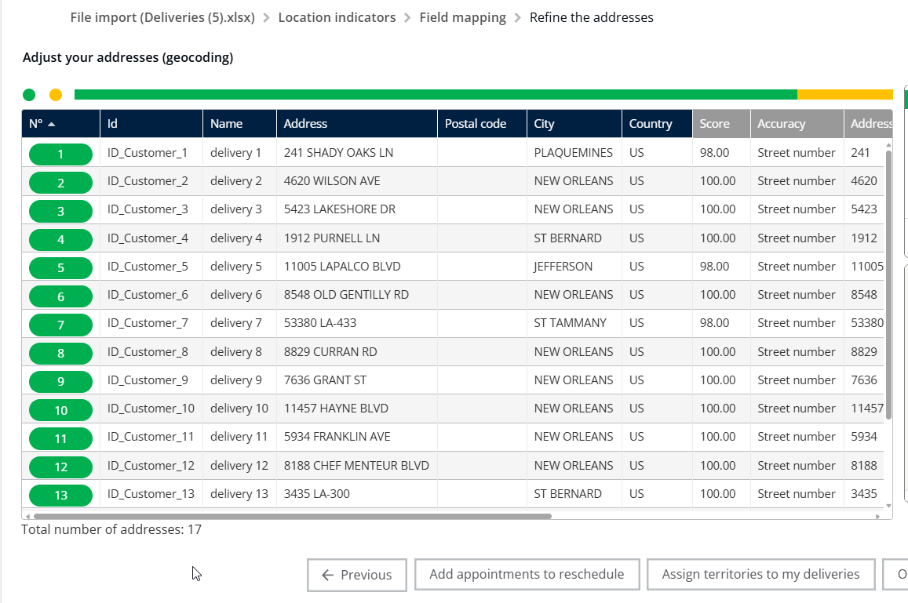

# Importación de entregas

## 1. Introducción

¡Bienvenido! Esta guía está diseñada para que la importación de tus datos de entrega al servidor sea una experiencia fluida y exitosa.

La Importación de Entregas te permite cargar una lista de direcciones e información de clientes directamente en el sistema para su visualización y optimización de rutas. Siguiendo estos sencillos pasos, podrás asignar las columnas de tu hoja de cálculo a los campos requeridos por el sistema, visualizar las ubicaciones en un mapa y comenzar a optimizar sus rutas de entrega.

***

## 2. Configuración Inicial

#### Accediendo a Mis Entregas

Para comenzar a importar tus entregas, primero debes navegar:

1. Desde el menú principal a **Mis Entregas**.
2. Ahora está listo para importar sus **Datos.**

#### Descargando Datos de Ejemplo

Si no estás seguro de cómo formatear tu archivo de Excel, puedes descargar una plantilla de ejemplo. Usar los datos de ejemplo garantiza que tu archivo esté listo para la importación de inmediato.

1. Haz clic en **Descargar**.
2. El archivo de Excel que contiene datos de ejemplo se descargará.

<figure><figcaption></figcaption></figure>

<figure><figcaption></figcaption></figure>

💡 **Consejo** : Usa siempre los datos de ejemplo proporcionados si es nuevo en la estructura del sistema. ¡Esto suele reducir posibles errores de asignación más adelante!

***

## 3. Explicaciones de Funciones con Beneficios

El proceso de importación incluye varios pasos clave que ayudan a garantizar que sus datos estén preparados con precisión para la planificación de rutas:

| Función                        | Contexto y Beneficio                                                                                                                                                                                                                                   |
| ------------------------------ | ------------------------------------------------------------------------------------------------------------------------------------------------------------------------------------------------------------------------------------------------------ |
| **Asignación de Datos**        | Esto garantiza que los encabezados de columna en su hoja de cálculo cargada (como "Cust ID" o "Client Name") estén correctamente relacionados con los campos que utiliza el servidor. Esta coincidencia precisa es crucial para una enrutación exacta. |
| **Colores de Geocodificación** | Después de la importación, el sistema intenta automáticamente encontrar la ubicación precisa (geocodificar) de cada dirección de entrega. Los colores indican éxito o fallo, lo que le permite detectar y corregir errores rápidamente.                |
| **Optimización de Rutas**      | Este es el paso final donde el sistema calcula el orden y la ruta más eficiente para sus entregas importadas.                                                                                                                                          |

## 4. Importación de Entregas y Optimización de Rutas

Esta tarea cubre el proceso de cargar sus datos de entrega, verificar la correspondencia de campos e iniciar la planificación de rutas.

#### Importación de Datos y Asignación de Campos

Debes indicar al sistema qué columnas de tu hoja de cálculo corresponden a los campos del sistema (como ID de Cliente o Nombre).

1. Haz clic en **importar** para iniciar el proceso de importación de tus datos de entrega al servidor

<figure><figcaption></figcaption></figure>

2. Aparecerá una ventana de asignación que te pedirá que iguale sus campos de Excel con los campos requeridos por el servidor.
3. Si un campo ya está asignado correctamente (como ocurre si usa la plantilla), puedes omitir la asignación de ese campo.

**Para restablecer o ajustar una asignación de campo (usando ID de Cliente y Nombre como ejemplo):**

4. Si un campo está actualmente asignado, puedes optar por ignorarlo.
5. Haz clic en _ignorado_ para asignar el campo a una restricción diferente de TourSolver.

<figure><figcaption></figcaption></figure>

<figure><figcaption></figcaption></figure>

6. Haz clic en **mostrar todo** para ver todas las opciones de campo posibles.

<figure><figcaption></figcaption></figure>

7. Haz clic en el **ID de Cliente** opción para asignarlo.

<figure><figcaption></figcaption></figure>

8. Si necesitas cambiar el campo Nombre, haz clic en ignorar debajo de la asignación de nombre actual.

<figure><figcaption></figcaption></figure>

9. Haz clic en **Nombre** para completar la asignación del campo de nombre

<figure><figcaption></figcaption></figure>

#### Revisando los Datos y los resultados de Geocodificación

Después de confirmar la asignación de datos, puedes proceder a la vista de mapa para revisar los resultados de la geocodificación.

1. Haz clic en **Siguiente** una vez que la asignación esté completa

<figure><figcaption></figcaption></figure>

2. Aparecerá la vista de mapa, mostrando tus ubicaciones con colores de geocodificación

<figure><figcaption></figcaption></figure>

3. Revisa las **ubicaciones** y sus **colores**.
4. Si ves ubicaciones grises, esas direcciones no fueron encontradas por el sistema. Es posible que debas revisar y corregir esas direcciones en tus datos originales antes de optimizar la ruta para mayor precisión

<figure><figcaption></figcaption></figure>

5. Haz clic en **Optimizar mis rutas** para iniciar el cálculo de la ruta

<figure><figcaption></figcaption></figure>

6. Una vez que **inicie la optimización**, el sistema comenzará el proceso de cálculo.

<figure><figcaption></figcaption></figure>

## 5. Comprendiendo el Estado de la Geocodificación

Cuando aparezca la vista de mapa, los colores le guían para entender si tus direcciones fueron localizadas con éxito (geocodificadas):

* **Color amarillo** indica que la ubicación fue geocodificada con éxito a nivel de calle.

<figure><figcaption></figcaption></figure>

* Color verde indica que la ubicación fue geocodificada con éxito a nivel de edificio.

<figure><figcaption></figcaption></figure>

<figure><figcaption></figcaption></figure>

* **Color gris** indica que la ubicación no fue geocodificada.

<figure><figcaption></figcaption></figure>

<figure><figcaption></figcaption></figure>

***

## 6. Consejos de Productividad

Aquí hay algunas formas de hacer que la importación de tus datos sea más rápida y precisa:

* 💡 **Priorice lo amarillo:** Al revisar la vista de mapa, sabe que las ubicaciones amarillas son fiables (geocodificadas en las calles). Centre tu atención en cualquier ubicación marcada **Gris**.
* 💡 **Domina la eficiencia en la asignación:** Si necesitas cambiar rápidamente cómo se asigna un campo, recuerda que puedes optar por **ignorar** la asignación actual y luego seleccionar inmediatamente el nombre de campo correcto. Esto es más rápido que corregir los datos en tu hoja de cálculo fuera del sistema.
