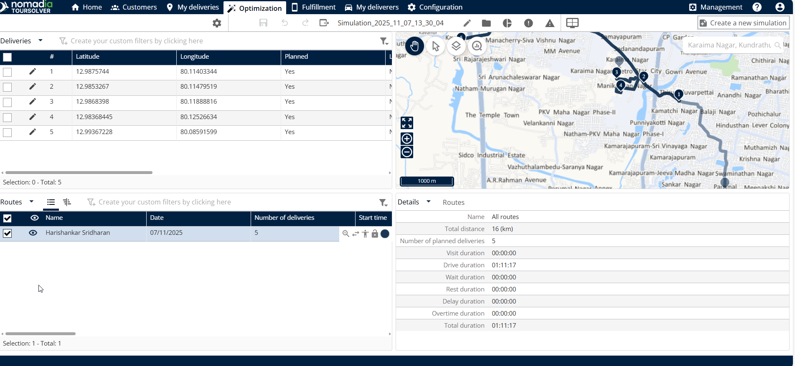
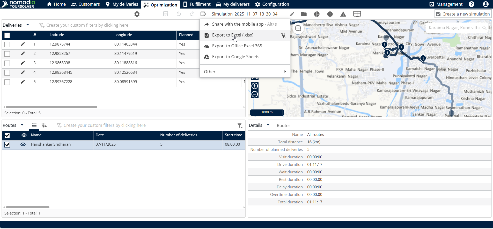
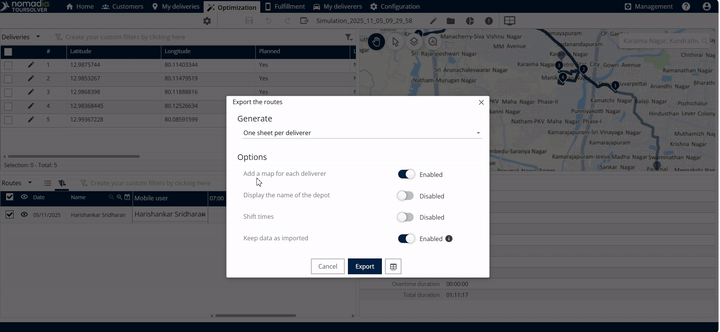
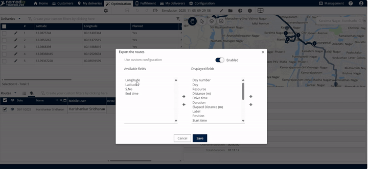
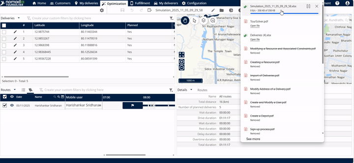
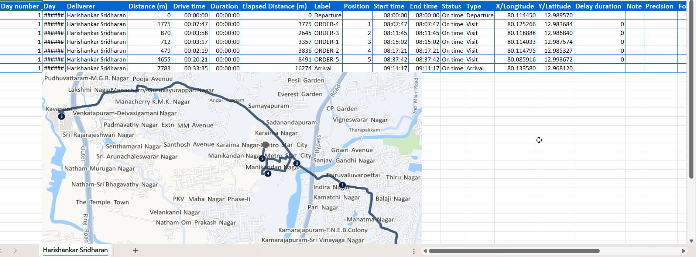

# Exportar mis rutas

## 1. Introducción

Esta guía le enseñará cómo seleccionar, personalizar y exportar sus rutas completadas utilizando el sistema de gestión de rutas. Ya sea que necesite compartir resultados con un miembro del equipo mediante Excel o integrar datos en un calendario, este proceso está diseñado para ser sencillo y efectivo.

## 2. Configuración Inicial

**Personalización de la configuración de exportación a Excel**

Cuando elija exportar a Excel, el sistema ofrece varias opciones para adaptar el archivo resultante.

1.  **Seleccione el diseño de la hoja:** Elija cómo se organiza la información de la ruta:

    * **Una hoja para todos los repartidores**.
    * **Una hoja por repartidor**.
    * _**Contexto**:_ Esto le ayuda a decidir si desea una vista consolidada o informes detallados para miembros individuales del equipo.

    
<figure><figcaption></figcaption></figure>

💡 **Consejo:** Estas configuraciones solo se aplican a la opción de exportación a Excel. Otros formatos (como PowerPoint o Calendario) usarán sus configuraciones de salida estándar.

2. **Seleccionar campos personalizados (columnas)**

Puede elegir qué columnas específicas (campos) aparecen en su archivo exportado.

1. Haz clic en **otro** dentro de la ventana de configuración.
2. Verá una lista de **campos disponibles** y **campos de visualización**.

<figure><figcaption></figcaption></figure>

3. También puede **habilitar la configuración personalizada** si es necesario.

* _Contexto:_ Cuando termine, el archivo de exportación contendrá tanto **columnas estándar como mapeadas**.

4. Haz clic en **Guardar** cuando haya terminado de personalizar los campos.

***

## 3. Explicaciones de la Función y Beneficios

El beneficio principal de la función de exportación de rutas es su flexibilidad, que le permite compartir datos rápidamente en formatos adecuados para diversos interesados.

#### Destinos de exportación diversos

Haciendo clic en el **opción de exportación** y seleccionando **otro**, desbloquea una amplia variedad de tipos de exportación.

| Función de exportación                                            | Beneficio/Utilidad                                                                                               |
| ----------------------------------------------------------------- | ---------------------------------------------------------------------------------------------------------------- |
| **Exportar a Excel**                                              | Ideal para análisis de datos detallados, cálculos e informes estructurados.                                      |
| **Exportar a PowerPoint / Office 365 PowerPoint / Google Slides** | Útil para generar rápidamente presentaciones o resúmenes para reuniones.                                         |
| **Exportar a Calendario (Office Outlook / Google)**               | Permite que los horarios y tiempos de las rutas se integren directamente en calendarios personales o del equipo. |
| **Exportar un resumen de rutas enviado por correo electrónico**   | Comparte de manera eficiente una visión general de alto nivel del plan de rutas con los destinatarios.           |
| **Exportar a Masternaut .GPX / .GPX extendido**                   | Necesario para su uso con sistemas de navegación GPS específicos o software de mapeo avanzado.                   |
| **Exportar a formato KML Google, etc.**                           | Formato estándar para ver datos geoespaciales (como rutas) en herramientas de mapeo (por ejemplo, Google Earth). |
| **Exportar a Webhook**                                            | Facilita la transferencia automatizada de datos a otros sistemas operativos.                                     |

## 4. Exportar una ruta a Excel

Esta es la tarea más común e incluye seleccionar la ruta, elegir el destino, configurar los ajustes y finalizar la descarga.

Siga estos pasos para exportar con éxito la ruta seleccionada:

**Localizar la sección de Optimización**

1. Comience desde la **página de inicio**. Haga clic en Optimización

**Seleccionar la ruta**

2. **Haga clic en la ruta** que desea exportar.

<figure><figcaption></figcaption></figure>

3. **Iniciar el diálogo de exportación**

**Elegir el formato Excel**

4. Como desea exportar los datos a Excel, haga clic en **exportar a Excel**.

<figure><figcaption></figcaption></figure>

**Configurar y generar el archivo**

5. Revise y ajuste sus configuraciones iniciales (Diseño de la hoja, Tiempos, Integridad de datos) como se describe en la Sección 2.

<figure><figcaption></figcaption></figure>

6. Si personalizó campos, asegúrese de que haya hecho clic en **Guardar**.

<figure><figcaption></figcaption></figure>

**Finalizar exportación y abrir archivo**

7. Haz clic en la **archivo descargado** para abrirlo

<figure><figcaption></figcaption></figure>

8. Por favor, encuentre el **archivo de Excel descargado** a continuación.

<figure><figcaption></figcaption></figure>

***

## 5. Consejos de Productividad

Aquí hay algunas formas de hacer que el proceso de exportación de rutas sea más eficiente:

* **Personalice las columnas para mayor eficiencia (filtrar datos):** Si solo necesita dos o tres puntos de datos específicos para un análisis rápido, use la **otro** opción en el menú de configuración para eliminar campos innecesarios. Esto mantiene su informe limpio y centrado, asegurando que el archivo exportado contenga solo **columnas estándar como mapeadas** que más importan.
* **Use la exportación a calendario para la programación:** En lugar de exportar datos complejos, use la **opción exportar a calendario** (Office Outlook o Google) para dar rápidamente a los repartidores sus horarios finales de turno y citas de ruta, simplificando la logística diaria.
* **Ahorrar tiempo de configuración:** Una vez que haya configurado el diseño de hoja y la selección de campos deseados (como generar **una hoja por repartidor** o incluir **tiempos de turno**), haga clic en **Guardar**. Esto le permite ejecutar rápidamente la exportación en el futuro sin volver a seleccionar todas las configuraciones detalladas.
