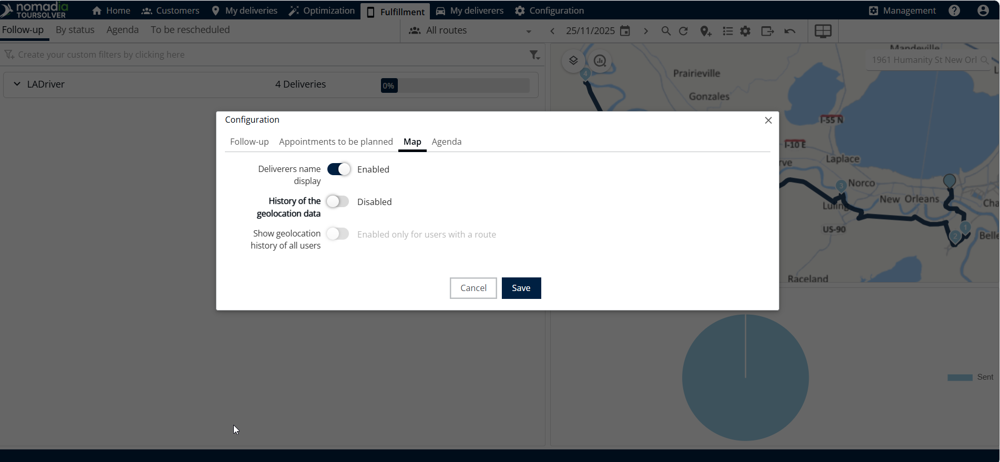

# ¿Cómo geolocalizo a mi personal de entrega?

## 1. Introducción

Poder localizar a su equipo de entrega en tiempo real es crucial para una gestión eficaz de los recursos. Esta guía simplifica el proceso de habilitar los accesos necesarios y configurar los ajustes de la aplicación móvil para que pueda rastrear fácilmente a su personal de entrega.

## 2. Configuración Inicial

Antes de comenzar, el sistema asume que ya ha configurado a las personas de entrega y sus rutas planificadas. Si estos pasos no están completos, primero debe crear la entrega, las personas de entrega y la ruta.

### Requisitos del Sistema (Configuración de Acceso)

Para asegurar un rastreo exitoso, su personal de entrega debe tener los permisos correctos y el acceso habilitado tanto en la plataforma web como en la aplicación móvil.

**Acción Previa Requerida**

| Tipo de Acceso                             | Descripción                                                           |
| ------------------------------------------ | --------------------------------------------------------------------- |
| **Configuración del Repartidor y la Ruta** | La persona de entrega y su ruta asignada deben estar ya creadas.      |
| **Acceso Web**                             | Necesario para iniciar sesión en el sistema.                          |
| **Acceso Móvil**                           | Requerido para usar la aplicación móvil, la cual facilita el rastreo. |

## 3. Explicación de Funciones y Beneficios

El sistema ofrece funciones clave que le ayudan a gestionar la seguridad, los permisos y la visibilidad del rastreo:

* **Gestión de Roles y Permisos**: Aquí es donde otorga a sus repartidores los permisos necesarios para operar dentro del sistema.
* **Configuración de la App Móvil**: Esta sección le permite ajustar cómo la aplicación móvil se comunica con el sistema, incluida la velocidad de sincronización y la visibilidad de la agenda.
* **Ajustes de Privacidad**(**Cumplimiento GDPR**): Usted tiene la capacidad de limitar cuándo ocurre el rastreo, cumpliendo con las normas de privacidad de datos. Esto genera confianza y asegura el cumplimiento legal al restringir el rastreo por geolocalización únicamente a las horas y días laborales.

## 4. Habilitar el Rastreo por Geolocalización

### Configurar la App Móvil

**Editar ajustes generales.**&#x20;

1. Número de días alcanzables en la agenda
2. Frecuencia de sincronización automática
3. Mostrar información de tiempo de viaje

4. **Establecer Reglas de Privacidad**: En la configuración de la aplicación móvil, habilite la privacidad de acuerdo con las normas pertinentes (como el GDPR).

⚠ **Advertencia**: Si está operando en una región con leyes estrictas de privacidad de datos (como el GDPR), asegúrese de habilitar el rastreo solo durante las horas y los días laborales para mantenerse conforme.

### Ver la Geolocalización en la Pestaña de Cumplimiento

1. Una vez completada la configuración, puede acceder a la vista de rastreo en la Pestaña de Cumplimiento
2. **Seleccionar Fecha**: Introduzca la fecha específica que se ha programado para la ruta que desea rastrear.

>)

3. **Abrir Ajustes de Visualización**: Haga clic en **ajustes**.
4. **Modificar Vista de Rastreo**: Aquí puede ajustar cómo se muestra la información de rastreo: **Campos disponibles, Campos de visualización, Citas por planificar, Mapa y Agenda**

<figure><figcaption></figcaption></figure>

3. Haga clic en el mapa para activar y mostrar el historial de geolocalización.

<figure><figcaption></figcaption></figure>

## 5. Consejos de Productividad

Aquí tiene algunos consejos para maximizar el uso de la función de rastreo:

* **Personalice Su Vista**: Use el menú de ajustes en la pestaña de Cumplimiento para modificar lo que ve en la pantalla. Si solo necesita el rastreo de ubicación, asegúrese de que las **mapa** y **agenda** las visualizaciones estén habilitadas.
* **Monitorear el Tiempo de Viaje**: Asegúrese de revisar la configuración de la aplicación móvil para **mostrar información de tiempo de viaje**. Esto le ayuda a predecir con precisión los tiempos de llegada y gestionar las expectativas.
* **Mantenga la Sincronización Frecuente**: Si el rastreo en tiempo real es crítico, verifique la **frecuencia de sincronización automática** configuración en la configuración de la aplicación móvil. Una mayor frecuencia proporciona actualizaciones de ubicación más inmediatas.
