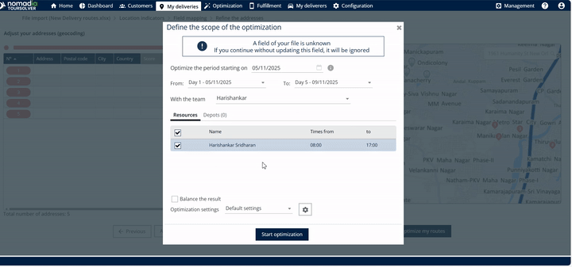
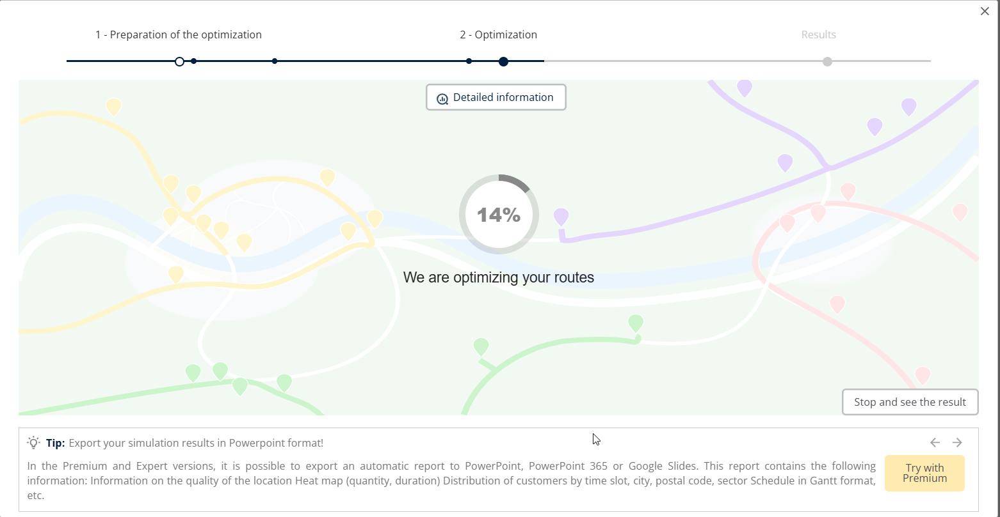
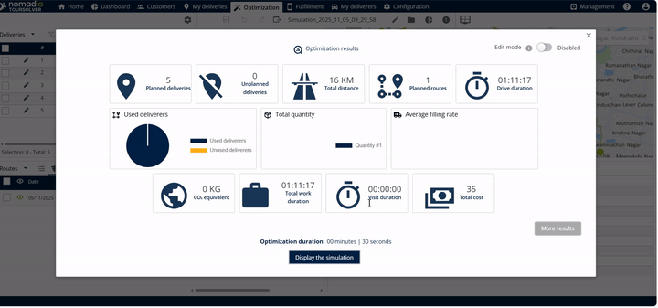
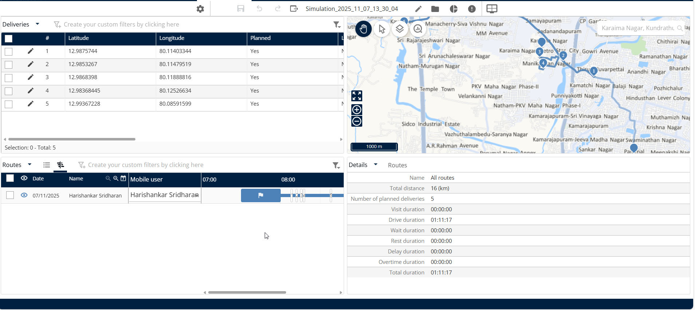
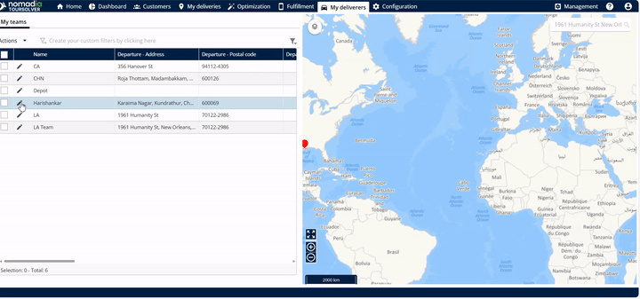
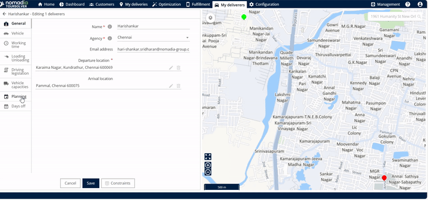
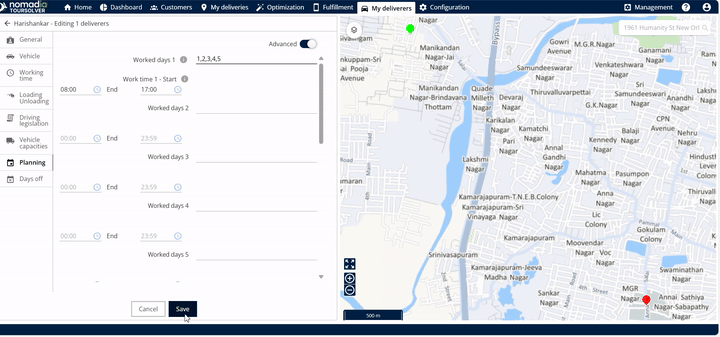

# Optimiza tus entregas

## 1. Introducción

El **Optimiza tus Entregas** la función agiliza tus operaciones calculando la mejor secuencia y rutas de entrega posibles. Con esta guía, aprenderás a configurar tus preferencias de optimización y a iniciar con éxito el proceso de planificación de rutas.

***

## 2. Configuración Inicial

Para comenzar a usar la función de optimización, se asume que ya has importado tus datos de entrega al sistema.

Antes de poder empezar a optimizar, debes navegar hasta el punto de inicio del proceso.

1. Navega a **Mis Entregas**.
2. Después de asegurarte de que las entregas están importadas, haz clic **Siguiente**.
3. Haz clic en **Optimizar Mis Rutas**.

***

## 3. Explicaciones de la Función y Beneficios

El **Optimiza tus Entregas** ofrece dos características principales de personalización que te dan control sobre cómo se planifican las rutas:

* **Optimización de Rutas:** Esta función principal toma todas tus entregas importadas y calcula el horario de rutas más eficiente.
  * **Beneficio:** Entregas optimizadas con éxito, garantizando un uso eficiente del tiempo y los recursos.
* **Fechas de Optimización Editables:** Puedes especificar exactamente cuándo deben comenzar a ejecutarse las rutas optimizadas ingresando o editando la fecha de inicio y la fecha de finalización.
* **Días de Planificación Editables:** Tienes la capacidad de ajustar el número de días que el sistema debe planificar. Esto es útil si cambian tus necesidades operativas.

## 4. Inicio de la Optimización de Rutas

Esta tarea te guía para seleccionar el marco temporal e iniciar el proceso de cálculo de rutas.

1. **Establece el Rango de Fechas de Optimización:** En la pantalla de optimización, ingresa o edita la fecha de inicio y la fecha de finalización deseadas para las rutas optimizadas.
2. **Edita el Número de Días (Opcional):** Si es necesario, puedes ajustar el número de días de planificación directamente en esta pantalla.

<figure><figcaption></figcaption></figure>

3. Haz clic en **Iniciar Optimización**

<figure><figcaption></figcaption></figure>

#### Visualización de los Resultados de la Optimización

1. Haz clic en Iniciar Optimización

<figure><figcaption></figcaption></figure>

2. Una vez que la optimización esté en ejecución, puedes supervisar los resultados.

<figure><figcaption></figcaption></figure>

**Revisar Resultados:** Verás el resumen del resultado de la optimización.

3. Haz clic en **Mostrar la Simulación**

<figure><figcaption></figcaption></figure>

4. Las entregas se han optimizado con éxito.

<figure><figcaption></figcaption></figure>

#### Ajuste del Período de Planificación (Número de Días)

Si necesitas cambiar cuántos días debe planificar rutas el sistema, puedes configurar este ajuste dentro de **Mis Repartidores**.

1. Ir a **Mis Repartidores**
2. Localiza el recurso asociado con la entrega.

<figure><figcaption></figcaption></figure>

3. Haz clic en **Planificación**

<figure><figcaption></figcaption></figure>

3. **Editar Días:** Cambia el valor al nuevo número de días que deseas usar para la planificación.
4. Haz clic en **Guardar**

<figure><figcaption></figcaption></figure>

## 5. Consejos de Productividad

* ⏳ **Consejo: Ten Paciencia con Trabajos Grandes:** Si tienes muchas entregas que necesitan optimización, el proceso puede tardar más de lo esperado. Esto es normal porque el sistema está realizando cálculos complejos.
* ✅ **Consejo: Revisa los Resultados Temprano:** No siempre tienes que esperar a que termine todo el proceso. Si necesitas un resultado preliminar rápidamente, puedes hacer clic **Detener y ver el resultado** en cualquier momento durante el cálculo.
* 🎉 **Confirmación de Éxito:** Una vez que el sistema confirme que "Las entregas se han optimizado con éxito", sabrás que tus nuevas rutas están listas para implementar.
