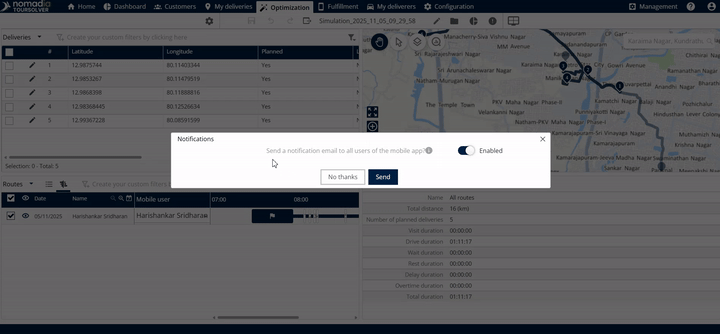
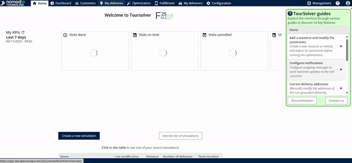
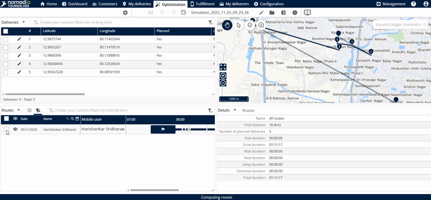
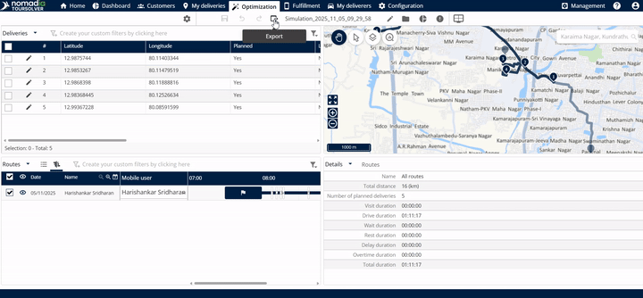
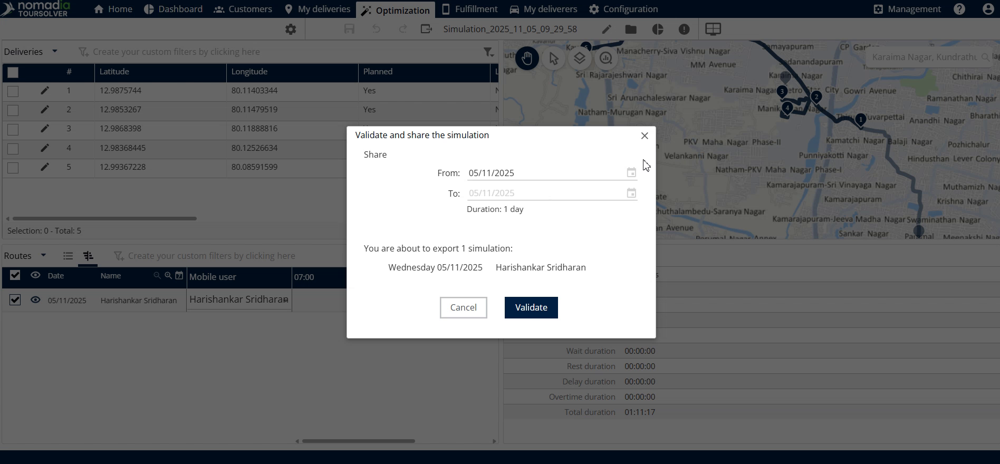
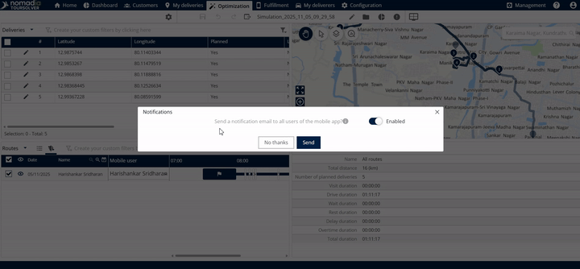
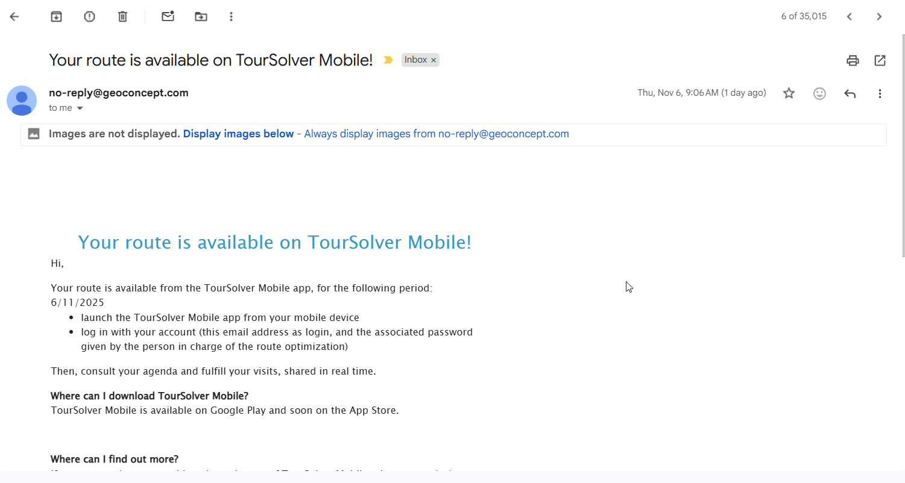

# Compartir una ruta con la app móvil

## 1. Introducción

Esta guía le explica el proceso para exportar una ruta planificada a la aplicación móvil utilizada por su equipo de campo. Este proceso garantiza que los usuarios móviles reciban una notificación por correo electrónico o SMS que contiene la ruta compartida y sus entregas asociadas.

## 2. Configuración Inicial

Para compartir con éxito una ruta, primero debe acceder a la sección de optimización y seleccionar una ruta completada.

| Tipo de cuenta        | Notificación enviada   | Contenido enviado                                                                                        |
| --------------------- | ---------------------- | -------------------------------------------------------------------------------------------------------- |
| **Versión de prueba** | Notificación SMS       | Enlace para descargar la aplicación móvil                                                                |
| **Versión suscrita**  | Correo de notificación | Notificación a todos los usuarios seleccionados de la aplicación móvil de que la ruta ha sido compartida |

## 3. Explicaciones de Funciones con Beneficios

El **Compartir con la aplicación móvil** la función es crucial para conectar sus esfuerzos de planificación con la ejecución en el mundo real.

* **Transferencia de ruta sin problemas:** Transfiera fácilmente rutas complejas y optimizadas (tours) directamente al dispositivo móvil donde se necesitan.
* **Compartir por fecha:** Puede controlar el rango de fechas exacto durante el cual la ruta estará activa y accesible en la aplicación móvil. Compartir una ruta para un rango de fechas específico (por ejemplo, duración de 1 día) confirma exactamente qué entregas deben realizarse en la(s) fecha(s) seleccionada(s).
* **Retroalimentación de confirmación:** El sistema proporciona retroalimentación clara sobre cuántas entregas se están compartiendo y cuántas notificaciones se están enviando a los usuarios móviles.

## 4. Comprensión de las notificaciones

Después de compartir la ruta, el sistema determina cómo se entregan las notificaciones según la configuración de su cuenta.

<figure><figcaption></figcaption></figure>

## 5. Compartir una ruta

Siga estos pasos detallados para compartir con éxito su ruta optimizada con sus usuarios móviles.

### Exportación y compartición de una ruta optimizada

1. Haz clic en **Optimización**

<figure><figcaption></figcaption></figure>

2. Elija la **ruta deseada** de la lista

<figure><figcaption></figcaption></figure>

3. Haz clic en **Exportar** y haga clic en **Compartir con la aplicación móvil**

<figure><figcaption></figcaption></figure>

4. **Establecer la fecha de inicio (Desde):** Introduzca la fecha de inicio desde la cual desea que la ruta sea compartida.
5. Elija un **Fecha de inicio deseada**
6. **Establecer la fecha de finalización (Hasta):** Elija un "**a fecha**".

<figure><figcaption></figcaption></figure>

**Nota**: La duración estándar será de 1 día, pero puede ajustar la "fecha hasta" si es necesario para crear rutas de varios días.\
Interfaz de selección de fecha que muestra Desde, Hasta y Duración (1 día)

<figure><figcaption></figcaption></figure>

7. **Revisar la notificación (Prueba/Suscrito):** Lea la notificación de confirmación que se muestra según si está utilizando una versión de prueba o suscrita.
8. Haz clic en **Enviar**

<figure><figcaption></figcaption></figure>

&#x20; **Resultado esperado**: Ventana emergente de confirmación final que muestra detalles de las entregas compartidas y los correos enviados

<figure><figcaption></figcaption></figure>

## 6. Consejo de productividad

* **Consejo: Verifique los recuentos de entregas:** Preste siempre mucha atención a la notificación final que aparece cuando hace clic **enviar.** Este mensaje confirma exactamente cuántas entregas están incluidas en la ruta que está compartiendo y cuántos correos se están enviando a sus usuarios móviles.
