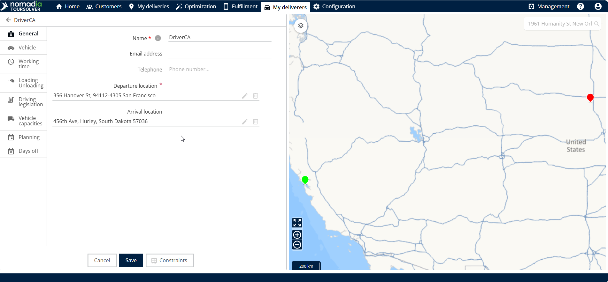
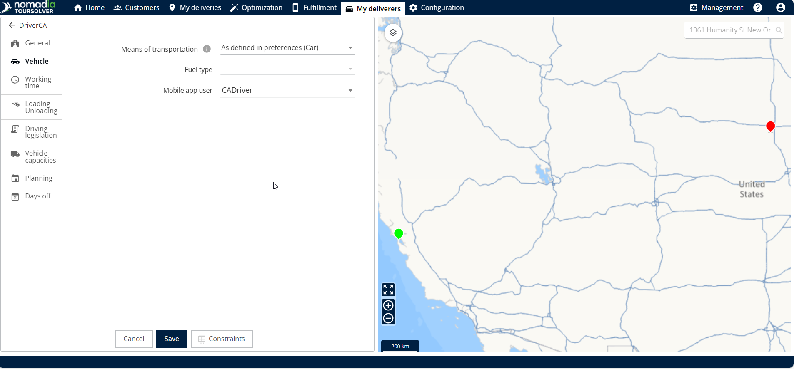
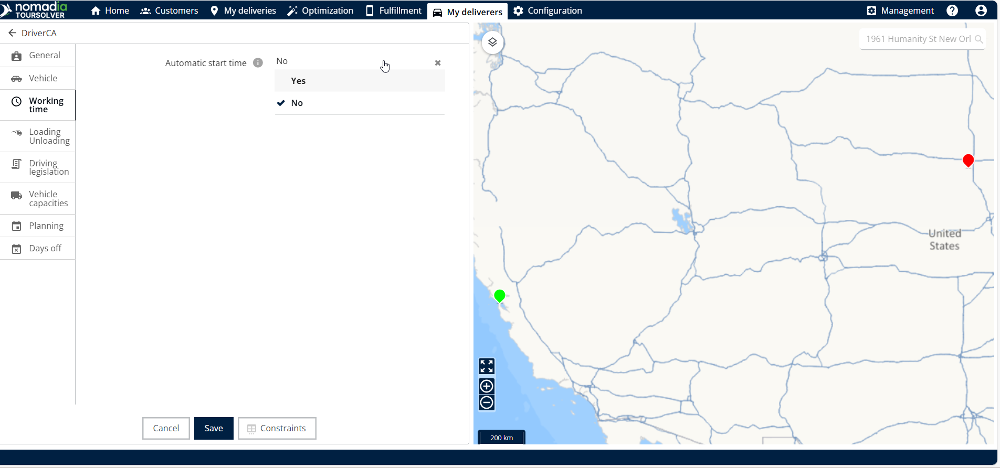
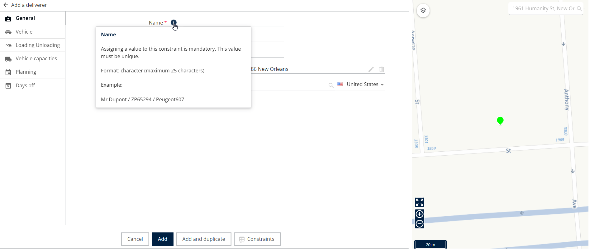

# Creación de un recurso

## 1. Introducción

¡Bienvenido! Esta guía te explicará los pasos sencillos para definir un Recurso, como un miembro del personal de entregas o un conductor, dentro de TourSolver. Nuestro objetivo es asegurarnos de que puedas configurar a los miembros de su equipo con precisión y confianza, permitiendo que el sistema gestione las asignaciones de vehículos, los horarios de trabajo y los días libres de forma efectiva.

## 2. Configuración Inicial

Para comenzar a definir un nuevo perfil de recurso:

1. Ve a la **Página de recurso.**
2. Haz clic en **Añadir** ubicado dentro del menú Acciones.

<figure><figcaption></figcaption></figure>

## 3. Explicaciones de la Función y Beneficios

* Crear un recurso implica completar varias pestañas que definen cómo opera su miembro del personal, cómo se desplaza y cuándo está disponible.
* **Detalles del recurso (Información general**): Aquí es donde identifica al miembro del personal por nombre y especifica su punto de partida, conocido como la ubicación de salida.
* **Pestaña Vehículos**: Aquí define la forma principal en que se desplaza el miembro del personal seleccionando el medio de transporte.
* **Pestaña Capacidades de Vehículos**: Esta sección es crucial para definir qué puede transportar el recurso (o su vehículo asignado). Puedes agregar capacidades del vehículo para garantizar que se cumplan las restricciones durante la planificación.
* **Pestañas Horario de Trabajo y Planificación**: Estas secciones definen la disponibilidad del miembro del personal, incluyendo la selección de si la función de hora de inicio automática está activa, la definición de franjas horarias de trabajo específicas y la programación de descansos para el almuerzo.
* **Pestaña Días Libres**: Esto te permite programar fechas específicas en las que el recurso no estará disponible

💡 Consejo: Si alguna vez no está seguro sobre un campo o una restricción mientras introduces detalles, puedes pasar el cursor sobre los iconos de ayuda para obtener aclaraciones. Cada ayuda proporciona una breve explicación de lo que controla esa restricción.

## 4. Creación del recurso

Sigues estos pasos para crear y definir con éxito a tu nuevo miembro del personal de entrega o conductor.

1. Ingresa el **nombre completo del recurso**.
2. Ingresa la **ubicación de salida** (donde el recurso comienza su turno).

<figure><figcaption></figcaption></figure>

3. Vea la **pestaña Vehículos.**
4. Selecciona el **medio de transporte** (p. ej., coche, bicicleta, camión).

<figure><figcaption></figcaption></figure>

5. Ve a la **pestaña Horario de trabajo.**
6. Seleccione si desea que la función de hora de inicio automática esté activa (sí o no).

<figure><figcaption></figcaption></figure>

### Establecer capacidades del vehículo

Si su recurso transporta mercancías, debe definir sus límites de capacidad:

1. Ve a la **pestaña Capacidades de Vehículos**.
2. Haz clic en el símbolo más **(+)** ubicado en la esquina inferior.
3. Agrega las capacidades necesarias del vehículo en los campos disponibles.

<figure><figcaption></figcaption></figure>

**Para eliminar una ranura de capacidad:** Si necesita eliminar una entrada de capacidad, haz clic en el icono de eliminar ubicado en el lado derecho.

### Gestionar horarios de trabajo (Planificación)

La pestaña Planificación te permite definir las franjas horarias de trabajo y los descansos específicos para el recurso.

#### Para agregar/editar franjas horarias de trabajo:

1. Ve a la **pestaña Planificación**.
2. Haz clic en la **franja horaria de trabajo**.
3. Haz clic en el botón **editar franja** botón.
4. Agrega los horarios específicos de trabajo y haz clic **editar**.

<figure><figcaption></figcaption></figure>

#### Para gestionar los descansos para el almuerzo:

1. Para editar la franja de trabajo existente de descanso para el almuerzo, haz clic en editar **descanso para el almuerzo**.
2. Agrega el **horario del descanso para el almuerzo.**
3. Haz clic en **editar** para guardar los cambios en la franja de trabajo del descanso para el almuerzo.
4. Para eliminar una franja de descanso para el almuerzo, haz clic en **eliminar descanso para el almuerzo**.

<figure><figcaption></figcaption></figure>

### Agregar días libres

Utilice la pestaña Días Libres para programar tiempo libre planificado:

1. Ve a la pestaña **Días Libres**.
2. Haz clic en el icono más **(+)** en el lado derecho para agregar una nueva entrada.
3. Agrega los horarios requeridos (desde fecha/hasta fecha) en los que el recurso estará libre.
4. Haz clic en el icono **agregar** para guardar la entrada.

⚠ **Advertencia**: Al establecer días libres, asegúrate de que la "Fecha hasta" (la fecha de finalización) sea mayor (más tardía) que la "Fecha desde" (la fecha de inicio).

<figure><figcaption></figcaption></figure>

### Finalizando la creación del recurso

1. Una vez que hayas completado todos los detalles necesarios en las distintas pestañas. Haz clic en **Añadir**.
2. El recurso se creará con éxito.

<figure><figcaption></figcaption></figure>

## 5. Consejos de Productividad

Estos consejos te ayudarán a gestionar horarios y restricciones de forma rápida y eficiente:

* **Comprender las restricciones**: Si no estás seguro de lo que controla una configuración específica, utiliza siempre los iconos de ayuda pasando el cursor sobre ellos para una explicación rápida.

<figure><figcaption></figcaption></figure>

* **Duplicar rápidamente franjas horarias de trabajo**: Si un recurso tiene varias franjas horarias de trabajo idénticas, puedes ahorrar tiempo haciendo clic en la opción duplicar franja horaria de trabajo y luego en duplicar para añadir rápidamente una copia.

<figure><figcaption></figcaption></figure>

* **Gestionar la capacidad**: Recuerda que siempre puede eliminar capacidades de vehículo no deseadas haciendo clic en el icono de eliminar en el lado derecho de la entrada.
