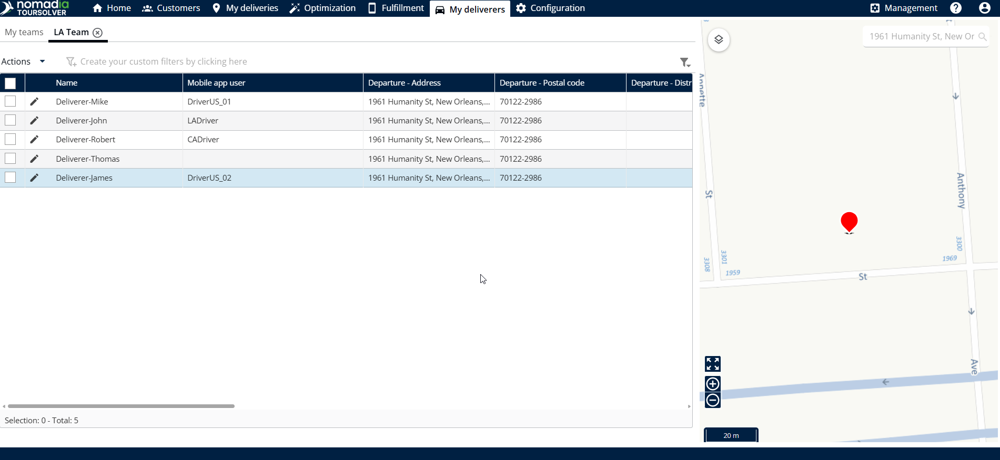
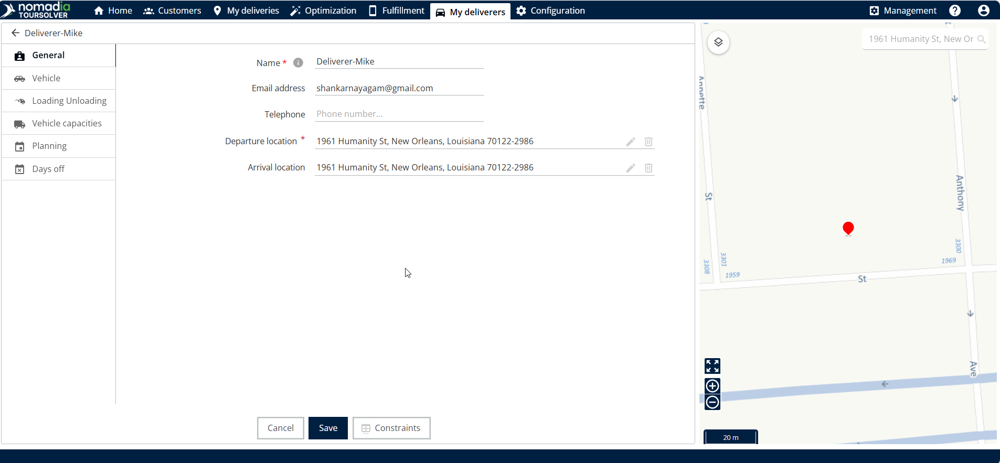
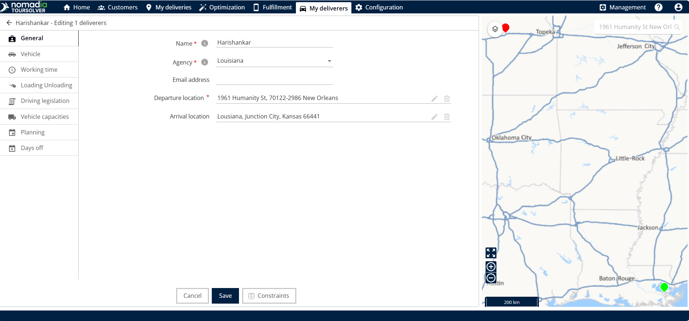
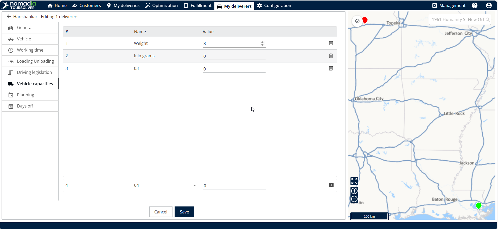
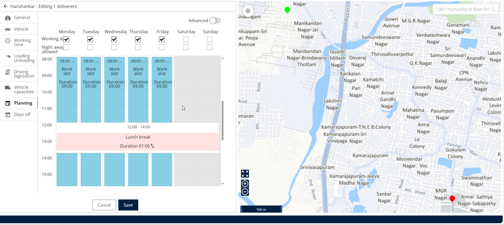
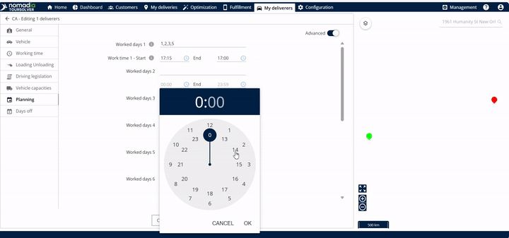
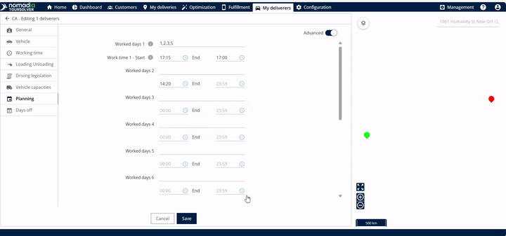

# Modificar un recurso y sus restricciones asociadas

## 1. Introducción

Bienvenido a tu guía para gestionar y actualizar de manera eficiente tus recursos de entrega y sus principales restricciones, o "constraints". Saber cómo modificar un recurso (ya sea ajustando la disponibilidad de un equipo o cambiando la capacidad del vehículo de una persona) es esencial para operaciones fluidas. En esta guía, aprenderá exactamente cómo cambiar la programación, las ubicaciones y las capacidades de forma rápida y exitosa

## 2. Configuración Inicial

Puede comenzar a modificar recursos y restricciones directamente desde la página principal del sistema.

#### Acceder a Mis Repartidores

<figure><figcaption></figcaption></figure>

1. **Elige tu método de modificación:** Tienes dos maneras principales de modificar un recurso: por equipo (afectando a un grupo) o individualmente.
2. Haz clic en el icono **editar** (lápiz) junto al nombre

<figure><figcaption></figcaption></figure>

3. Puedes comenzar a modificar las restricciones asociadas.

<figure><figcaption></figcaption></figure>

## 3. Explicaciones de la Función y Beneficios

Las restricciones son las reglas que rigen cuándo, dónde y cómo opera un recurso. Aquí están las restricciones comúnmente usadas explicadas:

* Ubicación de salida y llegada: Esta configuración define el punto de inicio y fin del día del recurso. Modificar estas ubicaciones es crucial si la dirección de inicio o final típica de un recurso cambia (por ejemplo, si trabaja desde otro depósito o regresa a casa).
* Capacidades del vehículo: Esto te permite establecer límites en la capacidad del vehículo, normalmente medida por peso. Esto garantiza que tu vehículo de entrega nunca esté sobrecargado, lo que ayuda con rutas seguras y conformes. Pueds establecer el valor de peso en kilogramos (kg) o gramos (g).
* Planificación (Intervalos de trabajo): Esto determina la disponibilidad laboral del recurso. Puedes gestionar horarios exactos de inicio y fin, y especificar qué días de la semana están disponibles.

**Consejo**: Para obtener más información sobre cualquier otra restricción, consulta la documentación de restricciones.

## 4. Modificación de las ubicaciones de salida y llegada

Una vez que hayas accedido a la pantalla de modificación de restricciones (usando el icono de lápiz), siga los pasos a continuación para actualizar los detalles específicos del recurso.

Si el punto de inicio o fin de un recurso cambia, puedes actualizarlo aquí.

1. **Localizar la dirección**: Para modificar la ubicación de salida o llegada en general, busque la sección relevante (Ubicación de salida o Ubicación de llegada).
2. **Actualizar dirección**: Modifique la dirección de salida y la de llegada según sea necesario.

<figure><figcaption></figcaption></figure>

Después de la modificación, verás las diferencias en el mapa. El color utilizado será diferente para las ubicaciones de salida y llegada (por ejemplo, verde o rojo).

### Actualización de las capacidades del vehículo (peso)

1. Puedes gestionar el peso máximo que el vehículo de un recurso puede transportar.
2. **Modificar valor**: Modifica el valor del peso. Puedes introducir este valor en kilogramos o gramos.

<figure><figcaption></figcaption></figure>

La sección de Planificación controla cuándo su recurso está disponible para trabajar. Hay dos métodos para modificar los tiempos de trabajo: Vista Simple y Vista Avanzada.

#### Vista Simple (Mismo horario todos los días)

Usa la Vista Simple si las horas de trabajo son las mismas en todos los días laborables.

1. **Acceder a Planificación**: Hagas clic en Planificación.
2. **Acceder al intervalo de tiempo**: En Vista Simple, hagas clic en el intervalo de tiempo.
3. **Editar intervalo de trabajo**: Haz clic en Editar intervalo de trabajo.
4. **Establecer horas de inicio y fin**: Modifica la hora de inicio y la hora de fin.
5. **Confirmar**: Haz clic en **Editar**.

<figure><figcaption></figcaption></figure>

#### Vista Avanzada (Horarios diferentes para distintos días)

Use la Vista Avanzada si necesita establecer horas de inicio y fin únicas para días laborales específicos.

1. **Acceder a Planificación**: Haa clic en Planificación.
2. **Seleccionar días laborables**: En Vista Avanzada, puede modificar los "días laborables" (por ejemplo, día laboral 1, día laboral 2, etc.). Puedes especificar un rango, como 1 a 5, que representa de lunes a viernes. También puede introducir días específicos como 1, 2, 3, 4, 5.
3. **Realizar ajustes**: La imagen del reloj se mostrará, permitiéndote realizar sus ajustes.
4. **Confirmar horario**: Después de realizar la modificación dentro del reloj, haz clic en OK.

<figure><figcaption></figcaption></figure>

#### Guardar todas las modificaciones

Una vez que haya completado todos los cambios necesarios en **Salida, Llegada, Capacidad y Planificación:**

* Los cambios se mostrarán correctamente

<figure><figcaption></figcaption></figure>

## 5. Consejos de Productividad

Para ayudarte a aprovechar al máximo la gestión de recursos:

* **Edición de tiempo eficiente**: Usa el icono del reloj junto a la hora para mostrar rápidamente la imagen del reloj y hacer ajustes precisos de la hora.
* **Eliminación rápida**: Si necesita eliminar un valor específico de capacidad del vehículo, busca inmediatamente al lado derecho de la entrada de peso el icono de eliminar.
