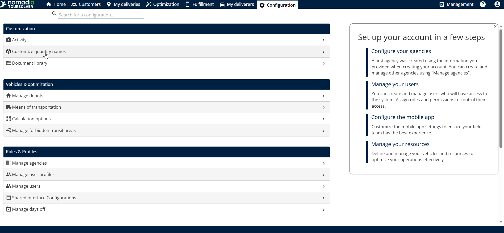
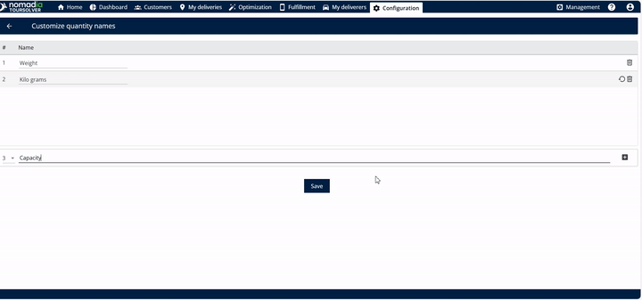
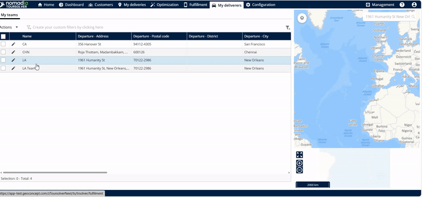
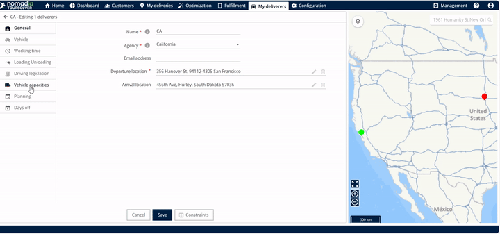
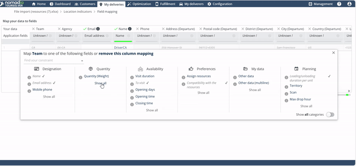

# Renombrar una cantidad de un vehículo

## 1. Introducción

Renombrar la cantidad de un vehículo te ayuda a personalizar la terminología del sistema. Al cambiar estos nombres, garantiza claridad y coherencia al ver las capacidades de los vehículos e importar nueva información de entregas. Está aprendiendo cómo renombrar con éxito la cantidad de un vehículo.

## 2. Configuración inicial

Ve a _**Configuración → Recursos → Vehículos**_ y renombra el campo **Cantidad** para reflejar su etiqueta preferida

## 3. Explicaciones de funciones y beneficios

La capacidad de personalizar los nombres de las cantidades ofrece un beneficio significativo al mostrar nombres definidos por el usuario en dos áreas clave:

* **Vista de capacidad del vehículo**: Después de renombrar, los nuevos nombres son visibles cuando revisas los detalles de capacidad de un vehículo. Esto te permite verificar rápidamente qué limitaciones de capacidad están asignadas a su flota.
* **Pantalla de importación de entregas**: Los nuevos nombres se muestran cuando importas nuevas entregas. Específicamente, aparecen cuando selecciona Mostrar todo en la sección de cantidades durante el proceso de importación, asegurando el mapeo correcto de los datos.

## 4. Renombrar una cantidad de vehículo

Sigue estos sencillos pasos para actualizar los nombres de las cantidades en su sistema:

1. **Acceder a Configuración**
2. **Navegar a Personalizar nombres de cantidad**

<figure><figcaption></figcaption></figure>

3. **Renombrar la Cantidad**
4. **Guardar sus cambios**

<figure><figcaption></figcaption></figure>

## 5. Verificar los nuevos nombres en las capacidades del vehículo

1. **Ir a Mis repartidores**
2. **Editar un vehículo**

<figure><figcaption></figcaption></figure>

3. **Ver capacidades del vehículo**
4. **Confirmar el nombre**

<figure><figcaption></figcaption></figure>

## 6. Verificar los nuevos nombres durante la importación de entregas

Las cantidades renombradas también son visibles cuando importa entregas:

1. **Ir a Mis entregas**
2. **Iniciar importación**
3. **Campos de dirección desconocida**
4. **Mostrar todas las cantidades**
5. **Confirmar el nuevo nombre**

<figure><figcaption></figcaption></figure>

## 7. Consejos de productividad

* **Consejo**: La verificación inmediata es clave Después de guardar la cantidad renombrada, tómate un momento para verificar inmediatamente el cambio tanto en Capacidades del vehículo como comprobando una importación de entrega pendiente. Esto asegura que tus cambios se propagaron correctamente en todo el sistema.
* **Consejo**: Mantenlo sencillo; usa nombres claros y concisos que sean fáciles de entender para todos en su equipo. Dado que el nuevo nombre se mostrará en múltiples áreas, elegir un lenguaje accesible evita confusiones.
* **Advertencia**: Asegúrate de haber actualizado todos los campos necesarios antes de hacer clic en Guardar para evitar tener que volver al menú de personalización varias veces.
